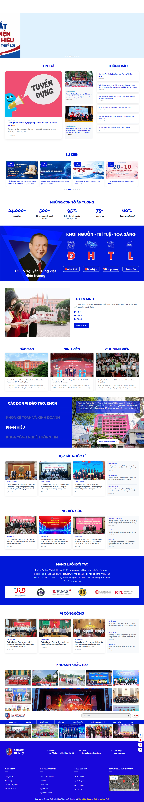

# Phân tích 23 component theo ba lớp song song

**Trạng thái:** toàn bộ HTML/CSS dưới đây là đề xuất học lại bố cục; không phải mã nguồn TLU. Ảnh ví dụ dùng ảnh khảo sát `assets/desktop.png` để có tệp tồn tại, không thay thế ảnh tin/logo thật. Link nội dung dùng URL trang chủ làm đích minh họa; không tuyên bố đó là URL bài hoặc bản tiếng Anh. Chưa triển khai JS tìm kiếm/menu/slider/lightbox. Các đoạn code dùng riêng; nếu ghép phải đổi id không trùng. Khi mở riêng COMPONENTS.md, `assets/` được hiểu là thư mục BTTH01/assets.

## Toàn trang — page

### 1. Nhận diện Layout Box

Cha: **document**. Hộp **page** gom nội dung toàn trang để điều khiển khoảng cách và thứ tự đọc. Cây dưới dùng chính các thẻ/class của ví dụ semantic, không suy diễn từ mã gốc.

```text
body.page
  header.site-header
    h1
  main.main-content
    section
      h2
      p
  footer.site-footer
    p
```

### 2. Tư duy dàn trang CSS

Normal Flow: body là gốc trang, header/main/footer là anh em. Chỉ có một main cho nội dung chính; không đặt main.page bao quanh main khác. Đây là khung rút gọn có nội dung, cây đầy đủ nằm ở README.

### 3. Nhận diện nội dung bên trong

| Nội dung/nhãn trong ví dụ | Hộp/thẻ | Vai trò và vì sao chọn thẻ |
|---|---|---|
| Trường Đại học Thủy lợi Giới thiệu trang chủTin tức và thông tin  | body .page | Gốc tài liệu chứa các landmark, không phải nội dung main |
| Trường Đại học Thủy lợi | header .site-header | Nhận diện và công cụ dùng chung của trang |
| Trường Đại học Thủy lợi | h1 | Tên trang, tiêu đề cao nhất |
| Giới thiệu trang chủTin tức và thông tin của trường. | main .main-content | Nội dung chính duy nhất của trang |
| Giới thiệu trang chủTin tức và thông tin của trường. | section | Chuyên mục được đặt tên bằng tiêu đề |
| Giới thiệu trang chủ | h2 | Tên chuyên mục hoặc vùng điều hướng |
| Tin tức và thông tin của trường. | p | Đoạn mô tả hoặc chú thích bằng văn bản |
| Thông tin liên hệ TLU | footer .site-footer | Liên hệ và liên kết cuối trang |

### 4. Phiên bản chỉ dùng div

Giữ cùng thứ tự và các hộp con của bản semantic; chữ trong ngoặc vuông biểu diễn ảnh/ô nhập. Div không có chức năng nhập, submit hay mở menu.

```html
<div class="page">
  <div class="site-header">
<div>Trường Đại học Thủy lợi</div>
</div>
  <div class="main-content">
<div>
<div>Giới thiệu trang chủ</div>
<div>Tin tức và thông tin của trường.</div>
</div>
</div>
  <div class="site-footer">
<div>Thông tin liên hệ TLU</div>
</div>
</div>
```

### 5. Phiên bản HTML Semantic

```html
<body class="page">
  <header class="site-header"><h1>Trường Đại học Thủy lợi</h1></header>
  <main class="main-content"><section aria-labelledby="intro-title"><h2 id="intro-title">Giới thiệu trang chủ</h2><p>Tin tức và thông tin của trường.</p></section></main>
  <footer class="site-footer"><p>Thông tin liên hệ TLU</p></footer>
</body>
```

### 6. CSS Layout minh họa

```css
.page { margin:0; }
.main-content { display:block; }
```

### 7. Kết luận tư duy và responsive

page → xác định items trực tiếp trong cây → chọn kỹ thuật ở mục 2 → gắn thẻ theo bảng mục 3. Đề xuất: giữ thứ tự đọc, ảnh co theo khung và kiểm tra nội dung dài ở màn hình hẹp.

## Nhận diện và công cụ — site-header

### 1. Nhận diện Layout Box

Cha: **page**. Hộp **site-header** gom nội dung nhận diện và công cụ để điều khiển khoảng cách và thứ tự đọc. Cây dưới dùng chính các thẻ/class của ví dụ semantic, không suy diễn từ mã gốc.

```text
header.site-header
  div.header-tools
    a.brand
      img.brand-image
    form.search-form
      label.search-label
      div.search-field
        input.search-input
        button.search-submit
    nav.language
      ul.language-list
        li
          a
        li
          a
    button.menu-open
```

### 2. Tư duy dàn trang CSS

Flex Container: .header-tools; items trực tiếp: .brand, .search-form, .language, .menu-open. .language-list là container flex lồng trong một item qua nav; items là li, không phải a. Header ngoài không cần display:flex. Logo là link chứa img; ngôn ngữ là nav có tên, không phải label đứng riêng.

### 3. Nhận diện nội dung bên trong

| Nội dung/nhãn trong ví dụ | Hộp/thẻ | Vai trò và vì sao chọn thẻ |
|---|---|---|
| Tìm kiếm trên TLU Tìm Tiếng Việt English (đích minh họa) Mở menu | header .site-header | Nhận diện và công cụ dùng chung của trang |
| Tìm kiếm trên TLU Tìm Tiếng Việt English (đích minh họa) Mở menu | div .header-tools | Hộp gom con để áp dụng layout, không tạo landmark |
| Hộp không có nhãn chữ riêng | a .brand | Đi tới trang, địa chỉ mail hoặc số điện thoại |
| Trang chủ Trường Đại học Thủy lợi — ảnh minh họa vị trí logo | img .brand-image | Nội dung hình ảnh; alt diễn đạt mục đích ảnh |
| Tìm kiếm trên TLU Tìm | form .search-form | Thu thập và gửi từ khóa tìm kiếm |
| Tìm kiếm trên TLU | label .search-label | Tên trường nhập, liên kết với input bằng for/id |
| Tìm | div .search-field | Hộp gom con để áp dụng layout, không tạo landmark |
| Hộp không có nhãn chữ riêng | input .search-input | Trường nhập từ khóa tìm kiếm có name |
| Tìm | button .search-submit | Kích hoạt thao tác bằng bàn phím hoặc chuột |
| Ngôn ngữ | nav .language | Nhóm liên kết điều hướng có tên truy cập |
| Tiếng Việt English (đích minh họa) | ul .language-list | Tập các mục cùng loại không cần đánh số |
| Tiếng Việt | li | Một phần tử của danh sách liên kết/tin/logo |
| Tiếng Việt | a | Đi tới trang, địa chỉ mail hoặc số điện thoại |
| Mở menu | button .menu-open | Kích hoạt thao tác bằng bàn phím hoặc chuột |

### 4. Phiên bản chỉ dùng div

Giữ cùng thứ tự và các hộp con của bản semantic; chữ trong ngoặc vuông biểu diễn ảnh/ô nhập. Div không có chức năng nhập, submit hay mở menu.

```html
<div class="site-header">
  <div class="header-tools">
    <div class="brand">
<div class="brand-image">[Ảnh: Trang chủ Trường Đại học Thủy lợi — ảnh minh họa vị trí logo]</div>
</div>
    <div class="search-form">
  <div class="search-label">Tìm kiếm trên TLU</div>
  <div class="search-field">
    <div class="search-input">[Ô nhập từ khóa]</div>
    <div class="search-submit">Tìm</div>
  </div>
</div>
    <div class="language">
  <div class="language-list">
    <div>
<div>Tiếng Việt</div>
</div>
    <div>
<div>English (đích minh họa)</div>
</div>
  </div>
</div>
    <div class="menu-open">Mở menu</div>
  </div>
</div>
```

### 5. Phiên bản HTML Semantic

```html
<header class="site-header">
  <div class="header-tools">
    <a class="brand" href="https://tlu.edu.vn/"></a>
    <form class="search-form" role="search" action="https://tlu.edu.vn/" method="get">
  <label class="search-label" for="header-query">Tìm kiếm trên TLU</label>
  <div class="search-field">
    <input class="search-input" id="header-query" name="q" type="search" placeholder="Nhập từ khóa">
    <button class="search-submit" type="submit">Tìm</button>
  </div>
</form>
    <nav class="language" aria-label="Ngôn ngữ">
  <ul class="language-list">
    <li><a href="https://tlu.edu.vn/" lang="vi" hreflang="vi" aria-current="page">Tiếng Việt</a></li>
    <li><a href="https://tlu.edu.vn/" lang="en" hreflang="en">English (đích minh họa)</a></li>
  </ul>
</nav>
    <button class="menu-open" type="button" aria-controls="mobile-menu" aria-expanded="false">Mở menu</button>
  </div>
</header>
```

### 6. CSS Layout minh họa

```css
.header-tools { display:flex; align-items:center; gap:1rem; flex-wrap:wrap; }
.header-tools > .search-form { flex:1; min-width:12rem; }
.language-list { display:flex; gap:.5rem; list-style:none; padding:0; }
```

### 7. Kết luận tư duy và responsive

site-header → xác định items trực tiếp trong cây → chọn kỹ thuật ở mục 2 → gắn thẻ theo bảng mục 3. Mobile: ẩn form tìm kiếm ở header và dùng form riêng trong drawer; chỉ ẩn .header-tools > .search-form, không ẩn tất cả form. Nav desktop và drawer do media query quyết định.

## Tìm kiếm — search-form

### 1. Nhận diện Layout Box

Cha: **header-tools hoặc mobile-drawer**. Hộp **search-form** gom nội dung tìm kiếm để điều khiển khoảng cách và thứ tự đọc. Cây dưới dùng chính các thẻ/class của ví dụ semantic, không suy diễn từ mã gốc.

```text
form.search-form
  label.search-label
  div.search-field
    input.search-input
    button.search-submit
```

### 2. Tư duy dàn trang CSS

Normal Flow cho label rồi field; Position cho nút submit. .search-field relative là mốc, .search-submit absolute phủ bên phải; padding input chừa chỗ. Label liên kết bằng for/id; name gửi giá trị, type=search mô tả dữ liệu; button submit gửi form. action và tham số q chỉ minh họa, chưa xác nhận hợp đồng tìm kiếm TLU. Mỗi lần dùng phải đổi id để không trùng.

### 3. Nhận diện nội dung bên trong

| Nội dung/nhãn trong ví dụ | Hộp/thẻ | Vai trò và vì sao chọn thẻ |
|---|---|---|
| Tìm kiếm trên TLU Tìm | form .search-form | Thu thập và gửi từ khóa tìm kiếm |
| Tìm kiếm trên TLU | label .search-label | Tên trường nhập, liên kết với input bằng for/id |
| Tìm | div .search-field | Hộp gom con để áp dụng layout, không tạo landmark |
| Hộp không có nhãn chữ riêng | input .search-input | Trường nhập từ khóa tìm kiếm có name |
| Tìm | button .search-submit | Kích hoạt thao tác bằng bàn phím hoặc chuột |

### 4. Phiên bản chỉ dùng div

Giữ cùng thứ tự và các hộp con của bản semantic; chữ trong ngoặc vuông biểu diễn ảnh/ô nhập. Div không có chức năng nhập, submit hay mở menu.

```html
<div class="search-form">
  <div class="search-label">Tìm kiếm trên TLU</div>
  <div class="search-field">
    <div class="search-input">[Ô nhập từ khóa]</div>
    <div class="search-submit">Tìm</div>
  </div>
</div>
```

### 5. Phiên bản HTML Semantic

```html
<form class="search-form" role="search" action="https://tlu.edu.vn/" method="get">
  <label class="search-label" for="search-query">Tìm kiếm trên TLU</label>
  <div class="search-field">
    <input class="search-input" id="search-query" name="q" type="search" placeholder="Nhập từ khóa">
    <button class="search-submit" type="submit">Tìm</button>
  </div>
</form>
```

### 6. CSS Layout minh họa

```css
.search-field { position:relative; }
.search-input { box-sizing:border-box; width:100%; padding:.75rem 4rem .75rem .75rem; }
.search-submit { position:absolute; right:.25rem; top:50%; transform:translateY(-50%); }
```

### 7. Kết luận tư duy và responsive

search-form → xác định items trực tiếp trong cây → chọn kỹ thuật ở mục 2 → gắn thẻ theo bảng mục 3. Đề xuất: giữ thứ tự đọc, ảnh co theo khung và kiểm tra nội dung dài ở màn hình hẹp.

## Điều hướng desktop — primary-nav

### 1. Nhận diện Layout Box

Cha: **site-header**. Hộp **primary-nav** gom nội dung điều hướng desktop để điều khiển khoảng cách và thứ tự đọc. Cây dưới dùng chính các thẻ/class của ví dụ semantic, không suy diễn từ mã gốc.

```text
nav.primary-nav
  ul.nav-list
    li.nav-item
      a.nav-link
        span
        span
      ul.nav-submenu
        li
          a
        li
          a
    li.nav-item
      a.nav-link
    li.nav-item
      a.nav-link
```

### 2. Tư duy dàn trang CSS

Nested Flex: .nav-list → li.nav-item; bên trong mỗi item, .nav-link → span nhãn và span biểu tượng. a để chuyển trang; submenu ul/li thể hiện danh sách con. Hover/focus-within là đề xuất; không phải kết quả kiểm thử bàn phím website gốc.

### 3. Nhận diện nội dung bên trong

| Nội dung/nhãn trong ví dụ | Hộp/thẻ | Vai trò và vì sao chọn thẻ |
|---|---|---|
| Điều hướng chính | nav .primary-nav | Nhóm liên kết điều hướng có tên truy cập |
| Giới thiệu⌄ Cơ cấu tổ chứcThông tin công khai Tin tức Tuyển sinh | ul .nav-list | Tập các mục cùng loại không cần đánh số |
| Giới thiệu⌄ Cơ cấu tổ chứcThông tin công khai | li .nav-item | Một phần tử của danh sách liên kết/tin/logo |
| Giới thiệu⌄ | a .nav-link | Đi tới trang, địa chỉ mail hoặc số điện thoại |
| Giới thiệu | span | Đoạn nhãn hoặc biểu tượng nội tuyến |
| Cơ cấu tổ chứcThông tin công khai | ul .nav-submenu | Tập các mục cùng loại không cần đánh số |
| Cơ cấu tổ chức | li | Một phần tử của danh sách liên kết/tin/logo |
| Cơ cấu tổ chức | a | Đi tới trang, địa chỉ mail hoặc số điện thoại |

### 4. Phiên bản chỉ dùng div

Giữ cùng thứ tự và các hộp con của bản semantic; chữ trong ngoặc vuông biểu diễn ảnh/ô nhập. Div không có chức năng nhập, submit hay mở menu.

```html
<div class="primary-nav">
  <div class="nav-list">
    <div class="nav-item">
<div class="nav-link">
<div>Giới thiệu</div>
<div>⌄</div>
</div>
      <div class="nav-submenu">
<div>
<div>Cơ cấu tổ chức</div>
</div>
<div>
<div>Thông tin công khai</div>
</div>
</div>
    </div>
    <div class="nav-item">
<div class="nav-link">Tin tức</div>
</div>
    <div class="nav-item">
<div class="nav-link">Tuyển sinh</div>
</div>
  </div>
</div>
```

### 5. Phiên bản HTML Semantic

```html
<nav class="primary-nav" aria-label="Điều hướng chính">
  <ul class="nav-list">
    <li class="nav-item"><a class="nav-link" href="https://tlu.edu.vn/"><span>Giới thiệu</span><span aria-hidden="true">⌄</span></a>
      <ul class="nav-submenu"><li><a href="https://tlu.edu.vn/">Cơ cấu tổ chức</a></li><li><a href="https://tlu.edu.vn/">Thông tin công khai</a></li></ul>
    </li>
    <li class="nav-item"><a class="nav-link" href="https://tlu.edu.vn/">Tin tức</a></li>
    <li class="nav-item"><a class="nav-link" href="https://tlu.edu.vn/">Tuyển sinh</a></li>
  </ul>
</nav>
```

### 6. CSS Layout minh họa

```css
.nav-list { display:flex; margin:0; padding:0; list-style:none; }
.nav-item { position:relative; flex:1; }
.nav-link { display:flex; justify-content:center; align-items:center; gap:.5rem; padding:.75rem; }
.nav-submenu { display:none; position:absolute; top:100%; left:0; min-width:12rem; z-index:2; }
.nav-item:hover > .nav-submenu, .nav-item:focus-within > .nav-submenu { display:block; }
```

### 7. Kết luận tư duy và responsive

primary-nav → xác định items trực tiếp trong cây → chọn kỹ thuật ở mục 2 → gắn thẻ theo bảng mục 3. Dưới 1025px đề xuất ẩn nav desktop và hiện nút mở drawer; breakpoint này có trong class gốc nhưng mã ở đây là bản học lại.

## Menu mobile — mobile-drawer

### 1. Nhận diện Layout Box

Cha: **page**. Hộp **mobile-drawer** gom nội dung menu mobile để điều khiển khoảng cách và thứ tự đọc. Cây dưới dùng chính các thẻ/class của ví dụ semantic, không suy diễn từ mã gốc.

```text
aside.mobile-drawer
  div.drawer-heading
    h2
    button.menu-close
  form.search-form
    label.search-label
    div.search-field
      input.search-input
      button.search-submit
  nav.drawer-nav
    details
      summary
      ul
        li
          a
        li
          a
    details
      summary
      ul
        li
          a
        li
          a
```

### 2. Tư duy dàn trang CSS

Position fixed bám viewport. .drawer-heading là Flex Container, items h2 và button. details/summary mang trạng thái mở nhóm con; form có label/input/submit. hidden là trạng thái ban đầu; cần JS bật/tắt hidden, đồng bộ aria-expanded của nút mở và trả focus. Ví dụ không tuyên bố đã có xử lý focus trap/Escape.

### 3. Nhận diện nội dung bên trong

| Nội dung/nhãn trong ví dụ | Hộp/thẻ | Vai trò và vì sao chọn thẻ |
|---|---|---|
| Điều hướng TLUĐóng menu Tìm kiếm trên TLU Tìm Giới thiệuCơ cấu tổ | aside .mobile-drawer | Thông báo bổ trợ hoặc panel điều hướng phụ |
| Điều hướng TLUĐóng menu | div .drawer-heading | Hộp gom con để áp dụng layout, không tạo landmark |
| Điều hướng TLU | h2 | Tên chuyên mục hoặc vùng điều hướng |
| Đóng menu | button .menu-close | Kích hoạt thao tác bằng bàn phím hoặc chuột |
| Tìm kiếm trên TLU Tìm | form .search-form | Thu thập và gửi từ khóa tìm kiếm |
| Tìm kiếm trên TLU | label .search-label | Tên trường nhập, liên kết với input bằng for/id |
| Tìm | div .search-field | Hộp gom con để áp dụng layout, không tạo landmark |
| Hộp không có nhãn chữ riêng | input .search-input | Trường nhập từ khóa tìm kiếm có name |
| Tìm | button .search-submit | Kích hoạt thao tác bằng bàn phím hoặc chuột |
| Điều hướng mobile | nav .drawer-nav | Nhóm liên kết điều hướng có tên truy cập |
| Giới thiệuCơ cấu tổ chứcThông tin công khai | details | Nhóm điều hướng có trạng thái mở/đóng |
| Giới thiệu | summary | Tên và điều khiển mở nhóm details |
| Cơ cấu tổ chứcThông tin công khai | ul | Tập các mục cùng loại không cần đánh số |
| Cơ cấu tổ chức | li | Một phần tử của danh sách liên kết/tin/logo |
| Cơ cấu tổ chức | a | Đi tới trang, địa chỉ mail hoặc số điện thoại |

### 4. Phiên bản chỉ dùng div

Giữ cùng thứ tự và các hộp con của bản semantic; chữ trong ngoặc vuông biểu diễn ảnh/ô nhập. Div không có chức năng nhập, submit hay mở menu.

```html
<div class="mobile-drawer">
  <div class="drawer-heading">
<div>Điều hướng TLU</div>
<div class="menu-close">Đóng menu</div>
</div>
  <div class="search-form">
  <div class="search-label">Tìm kiếm trên TLU</div>
  <div class="search-field">
    <div class="search-input">[Ô nhập từ khóa]</div>
    <div class="search-submit">Tìm</div>
  </div>
</div>
  <div class="drawer-nav">
    <div>
<div>Giới thiệu</div>
<div>
<div>
<div>Cơ cấu tổ chức</div>
</div>
<div>
<div>Thông tin công khai</div>
</div>
</div>
</div>
    <div>
<div>Đào tạo</div>
<div>
<div>
<div>Đại học</div>
</div>
<div>
<div>Sau đại học</div>
</div>
</div>
</div>
  </div>
</div>
```

### 5. Phiên bản HTML Semantic

```html
<aside class="mobile-drawer" id="mobile-menu" aria-labelledby="drawer-title" hidden>
  <div class="drawer-heading"><h2 id="drawer-title">Điều hướng TLU</h2><button type="button" class="menu-close">Đóng menu</button></div>
  <form class="search-form" role="search" action="https://tlu.edu.vn/" method="get">
  <label class="search-label" for="drawer-query">Tìm kiếm trên TLU</label>
  <div class="search-field">
    <input class="search-input" id="drawer-query" name="q" type="search" placeholder="Nhập từ khóa">
    <button class="search-submit" type="submit">Tìm</button>
  </div>
</form>
  <nav class="drawer-nav" aria-label="Điều hướng mobile">
    <details><summary>Giới thiệu</summary><ul><li><a href="https://tlu.edu.vn/">Cơ cấu tổ chức</a></li><li><a href="https://tlu.edu.vn/">Thông tin công khai</a></li></ul></details>
    <details><summary>Đào tạo</summary><ul><li><a href="https://tlu.edu.vn/">Đại học</a></li><li><a href="https://tlu.edu.vn/">Sau đại học</a></li></ul></details>
  </nav>
</aside>
```

### 6. CSS Layout minh họa

```css
.mobile-drawer:not([hidden]) { position:fixed; inset:0 auto 0 0; width:min(340px,90vw); overflow:auto; z-index:20; background:white; }
.drawer-heading { display:flex; justify-content:space-between; align-items:center; gap:1rem; }
```

### 7. Kết luận tư duy và responsive

mobile-drawer → xác định items trực tiếp trong cây → chọn kỹ thuật ở mục 2 → gắn thẻ theo bảng mục 3. Đề xuất: giữ thứ tự đọc, ảnh co theo khung và kiểm tra nội dung dài ở màn hình hẹp.

## Banner đầu trang — hero

### 1. Nhận diện Layout Box

Cha: **main-content**. Hộp **hero** gom nội dung banner đầu trang để điều khiển khoảng cách và thứ tự đọc. Cây dưới dùng chính các thẻ/class của ví dụ semantic, không suy diễn từ mã gốc.

```text
section.hero
  h2
  div.hero-frame
    img.hero-image
    div.hero-pagination
      button
      button
```

### 2. Tư duy dàn trang CSS

Position: .hero-frame là mốc cho pagination absolute; pagination là Flex Container chứa các button. DOM gốc có Swiper; ví dụ chỉ mô tả hộp, các nút chưa có JS đổi ảnh. Không suy ra slider từ hình.

### 3. Nhận diện nội dung bên trong

| Nội dung/nhãn trong ví dụ | Hộp/thẻ | Vai trò và vì sao chọn thẻ |
|---|---|---|
| Thông tin nổi bật 12 | section .hero | Chuyên mục được đặt tên bằng tiêu đề |
| Thông tin nổi bật | h2 | Tên chuyên mục hoặc vùng điều hướng |
| 12 | div .hero-frame | Hộp gom con để áp dụng layout, không tạo landmark |
| Ảnh khảo sát đại diện vị trí banner TLU | img .hero-image | Nội dung hình ảnh; alt diễn đạt mục đích ảnh |
| 12 | div .hero-pagination | Hộp gom con để áp dụng layout, không tạo landmark |
| Xem banner 1 | button | Kích hoạt thao tác bằng bàn phím hoặc chuột |

### 4. Phiên bản chỉ dùng div

Giữ cùng thứ tự và các hộp con của bản semantic; chữ trong ngoặc vuông biểu diễn ảnh/ô nhập. Div không có chức năng nhập, submit hay mở menu.

```html
<div class="hero">
  <div>Thông tin nổi bật</div>
  <div class="hero-frame">
<div class="hero-image">[Ảnh: Ảnh khảo sát đại diện vị trí banner TLU]</div>
    <div class="hero-pagination">
<div>1</div>
<div>2</div>
</div>
  </div>
</div>
```

### 5. Phiên bản HTML Semantic

```html
<section class="hero" aria-labelledby="hero-title">
  <h2 id="hero-title">Thông tin nổi bật</h2>
  <div class="hero-frame">
    <div class="hero-pagination"><button type="button" aria-label="Xem banner 1">1</button><button type="button" aria-label="Xem banner 2">2</button></div>
  </div>
</section>
```

### 6. CSS Layout minh họa

```css
.hero-frame { position:relative; }
.hero-image { display:block; width:100%; aspect-ratio:3/1; object-fit:cover; }
.hero-pagination { position:absolute; bottom:.5rem; left:50%; transform:translateX(-50%); display:flex; gap:.5rem; }
```

### 7. Kết luận tư duy và responsive

hero → xác định items trực tiếp trong cây → chọn kỹ thuật ở mục 2 → gắn thẻ theo bảng mục 3. Đề xuất: giữ thứ tự đọc, ảnh co theo khung và kiểm tra nội dung dài ở màn hình hẹp.

## Tin tức và thông báo — news-layout

### 1. Nhận diện Layout Box

Cha: **main-content**. Hộp **news-layout** gom nội dung tin tức và thông báo để điều khiển khoảng cách và thứ tự đọc. Cây dưới dùng chính các thẻ/class của ví dụ semantic, không suy diễn từ mã gốc.

```text
section.news-layout
  h2
  div.news-columns
    article.news-card.featured-news
      img.news-image
      div.news-body
        h3.news-title
          a
        p.news-summary
        time.news-date
    div.news-stack
      article.news-card
        img.news-image
        div.news-body
          h3.news-title
            a
          p.news-summary
          time.news-date
      article.news-card
        img.news-image
        div.news-body
          h3.news-title
            a
          p.news-summary
          time.news-date
    aside.announcements
      h2
      ul.compact-list
        li
          a
          time
        li
          a
          time
```

### 2. Tư duy dàn trang CSS

Grid: .news-columns chứa đúng ba items: tin lớn, chồng tin phụ, sidebar thông báo. Tỷ lệ 2:1:1.5 là đề xuất, không phải số đo gốc. H2 nằm ngoài grid để không thành cột thứ tư.

### 3. Nhận diện nội dung bên trong

| Nội dung/nhãn trong ví dụ | Hộp/thẻ | Vai trò và vì sao chọn thẻ |
|---|---|---|
| Tin tức Thông báo tuyển dụng giảng viên Bản tóm tắt minh họa giúp | section .news-layout | Chuyên mục được đặt tên bằng tiêu đề |
| Tin tức | h2 | Tên chuyên mục hoặc vùng điều hướng |
| Thông báo tuyển dụng giảng viên Bản tóm tắt minh họa giúp người đ | div .news-columns | Hộp gom con để áp dụng layout, không tạo landmark |
| Thông báo tuyển dụng giảng viên Bản tóm tắt minh họa giúp người đ | article .news-card featured-news | Bài tin có thể đọc độc lập với các tin khác |
| Ảnh khảo sát trang TLU dùng minh họa vị trí ảnh tin | img .news-image | Nội dung hình ảnh; alt diễn đạt mục đích ảnh |
| Thông báo tuyển dụng giảng viên Bản tóm tắt minh họa giúp người đ | div .news-body | Hộp gom con để áp dụng layout, không tạo landmark |
| Thông báo tuyển dụng giảng viên | h3 .news-title | Tiêu đề tin bên trong chuyên mục |
| Thông báo tuyển dụng giảng viên | a | Đi tới trang, địa chỉ mail hoặc số điện thoại |
| Bản tóm tắt minh họa giúp người đọc chọn bài cần xem. | p .news-summary | Đoạn mô tả hoặc chú thích bằng văn bản |
| 25/11/2026 | time .news-date | Ngày sự kiện hoặc ngày đăng với datetime máy đọc |
| Hoạt động đào tạo Bản tóm tắt minh họa giúp người đọc chọn bài cầ | div .news-stack | Hộp gom con để áp dụng layout, không tạo landmark |
| Hoạt động đào tạo Bản tóm tắt minh họa giúp người đọc chọn bài cầ | article .news-card | Bài tin có thể đọc độc lập với các tin khác |
| Thông báo Tin liên quan thứ nhất 25/11 Tin liên quan thứ hai 24/1 | aside .announcements | Thông báo bổ trợ hoặc panel điều hướng phụ |
| Tin liên quan thứ nhất 25/11 Tin liên quan thứ hai 24/11 | ul .compact-list | Tập các mục cùng loại không cần đánh số |
| Tin liên quan thứ nhất 25/11 | li | Một phần tử của danh sách liên kết/tin/logo |
| 25/11 | time | Ngày sự kiện hoặc ngày đăng với datetime máy đọc |

### 4. Phiên bản chỉ dùng div

Giữ cùng thứ tự và các hộp con của bản semantic; chữ trong ngoặc vuông biểu diễn ảnh/ô nhập. Div không có chức năng nhập, submit hay mở menu.

```html
<div class="news-layout">
  <div>Tin tức</div>
  <div class="news-columns">
    <div class="news-card featured-news">
  <div class="news-image">[Ảnh: Ảnh khảo sát trang TLU dùng minh họa vị trí ảnh tin]</div>
  <div class="news-body">
    <div class="news-title">
<div>Thông báo tuyển dụng giảng viên</div>
</div>
    <div class="news-summary">Bản tóm tắt minh họa giúp người đọc chọn bài cần xem.</div>
    <div class="news-date">25/11/2026</div>
  </div>
</div>
    <div class="news-stack">
<div class="news-card">
  <div class="news-image">[Ảnh: Ảnh khảo sát trang TLU dùng minh họa vị trí ảnh tin]</div>
  <div class="news-body">
    <div class="news-title">
<div>Hoạt động đào tạo</div>
</div>
    <div class="news-summary">Bản tóm tắt minh họa giúp người đọc chọn bài cần xem.</div>
    <div class="news-date">25/11/2026</div>
  </div>
</div>
<div class="news-card">
  <div class="news-image">[Ảnh: Ảnh khảo sát trang TLU dùng minh họa vị trí ảnh tin]</div>
  <div class="news-body">
    <div class="news-title">
<div>Hoạt động sinh viên</div>
</div>
    <div class="news-summary">Bản tóm tắt minh họa giúp người đọc chọn bài cần xem.</div>
    <div class="news-date">25/11/2026</div>
  </div>
</div>
</div>
    <div class="announcements">
<div>Thông báo</div>
<div class="compact-list">
  <div>
<div>Tin liên quan thứ nhất</div> <div>25/11</div>
</div>
  <div>
<div>Tin liên quan thứ hai</div> <div>24/11</div>
</div>
</div>
</div>
  </div>
</div>
```

### 5. Phiên bản HTML Semantic

```html
<section class="news-layout" aria-labelledby="news-heading">
  <h2 id="news-heading">Tin tức</h2>
  <div class="news-columns">
    <article class="news-card featured-news">
  
  <div class="news-body">
    <h3 class="news-title"><a href="https://tlu.edu.vn/">Thông báo tuyển dụng giảng viên</a></h3>
    <p class="news-summary">Bản tóm tắt minh họa giúp người đọc chọn bài cần xem.</p>
    <time class="news-date" datetime="2026-11-25">25/11/2026</time>
  </div>
</article>
    <div class="news-stack"><article class="news-card">
  
  <div class="news-body">
    <h3 class="news-title"><a href="https://tlu.edu.vn/">Hoạt động đào tạo</a></h3>
    <p class="news-summary">Bản tóm tắt minh họa giúp người đọc chọn bài cần xem.</p>
    <time class="news-date" datetime="2026-11-25">25/11/2026</time>
  </div>
</article><article class="news-card">
  
  <div class="news-body">
    <h3 class="news-title"><a href="https://tlu.edu.vn/">Hoạt động sinh viên</a></h3>
    <p class="news-summary">Bản tóm tắt minh họa giúp người đọc chọn bài cần xem.</p>
    <time class="news-date" datetime="2026-11-25">25/11/2026</time>
  </div>
</article></div>
    <aside class="announcements" aria-labelledby="notice-heading"><h2 id="notice-heading">Thông báo</h2><ul class="compact-list">
  <li><a href="https://tlu.edu.vn/">Tin liên quan thứ nhất</a> <time datetime="2026-11-25">25/11</time></li>
  <li><a href="https://tlu.edu.vn/">Tin liên quan thứ hai</a> <time datetime="2026-11-24">24/11</time></li>
</ul></aside>
  </div>
</section>
```

### 6. CSS Layout minh họa

```css
.news-columns { display:grid; grid-template-columns:2fr 1fr 1.5fr; gap:1rem; }
.news-stack { display:grid; gap:1rem; }
@media(max-width:767px) { .news-columns { grid-template-columns:1fr; } }
```

### 7. Kết luận tư duy và responsive

news-layout → xác định items trực tiếp trong cây → chọn kỹ thuật ở mục 2 → gắn thẻ theo bảng mục 3. Đề xuất: giữ thứ tự đọc, ảnh co theo khung và kiểm tra nội dung dài ở màn hình hẹp.

## Thẻ tin — news-card

### 1. Nhận diện Layout Box

Cha: **news-columns hoặc topic-grid**. Hộp **news-card** gom nội dung thẻ tin để điều khiển khoảng cách và thứ tự đọc. Cây dưới dùng chính các thẻ/class của ví dụ semantic, không suy diễn từ mã gốc.

```text
article.news-card
  img.news-image
  div.news-body
    h3.news-title
      a
    p.news-summary
    time.news-date
```

### 2. Tư duy dàn trang CSS

Normal Flow: ảnh trước, news-body sau; h3 chứa link, p tóm tắt, time ngày xuất bản. article có nghĩa vì mỗi tin đọc độc lập. Không cần Flex/Grid cho body xếp dọc.

### 3. Nhận diện nội dung bên trong

| Nội dung/nhãn trong ví dụ | Hộp/thẻ | Vai trò và vì sao chọn thẻ |
|---|---|---|
| Hoạt động đào tạo tại TLU Bản tóm tắt minh họa giúp người đọc chọ | article .news-card | Bài tin có thể đọc độc lập với các tin khác |
| Ảnh khảo sát trang TLU dùng minh họa vị trí ảnh tin | img .news-image | Nội dung hình ảnh; alt diễn đạt mục đích ảnh |
| Hoạt động đào tạo tại TLU Bản tóm tắt minh họa giúp người đọc chọ | div .news-body | Hộp gom con để áp dụng layout, không tạo landmark |
| Hoạt động đào tạo tại TLU | h3 .news-title | Tiêu đề tin bên trong chuyên mục |
| Hoạt động đào tạo tại TLU | a | Đi tới trang, địa chỉ mail hoặc số điện thoại |
| Bản tóm tắt minh họa giúp người đọc chọn bài cần xem. | p .news-summary | Đoạn mô tả hoặc chú thích bằng văn bản |
| 25/11/2026 | time .news-date | Ngày sự kiện hoặc ngày đăng với datetime máy đọc |

### 4. Phiên bản chỉ dùng div

Giữ cùng thứ tự và các hộp con của bản semantic; chữ trong ngoặc vuông biểu diễn ảnh/ô nhập. Div không có chức năng nhập, submit hay mở menu.

```html
<div class="news-card">
  <div class="news-image">[Ảnh: Ảnh khảo sát trang TLU dùng minh họa vị trí ảnh tin]</div>
  <div class="news-body">
    <div class="news-title">
<div>Hoạt động đào tạo tại TLU</div>
</div>
    <div class="news-summary">Bản tóm tắt minh họa giúp người đọc chọn bài cần xem.</div>
    <div class="news-date">25/11/2026</div>
  </div>
</div>
```

### 5. Phiên bản HTML Semantic

```html
<article class="news-card">
  
  <div class="news-body">
    <h3 class="news-title"><a href="https://tlu.edu.vn/">Hoạt động đào tạo tại TLU</a></h3>
    <p class="news-summary">Bản tóm tắt minh họa giúp người đọc chọn bài cần xem.</p>
    <time class="news-date" datetime="2026-11-25">25/11/2026</time>
  </div>
</article>
```

### 6. CSS Layout minh họa

```css
.news-card { min-width:0; }
.news-image { display:block; width:100%; aspect-ratio:16/9; object-fit:cover; }
.news-body { padding:1rem; }
```

### 7. Kết luận tư duy và responsive

news-card → xác định items trực tiếp trong cây → chọn kỹ thuật ở mục 2 → gắn thẻ theo bảng mục 3. Đề xuất: giữ thứ tự đọc, ảnh co theo khung và kiểm tra nội dung dài ở màn hình hẹp.

## Danh sách thông báo — announcements

### 1. Nhận diện Layout Box

Cha: **news-columns**. Hộp **announcements** gom nội dung danh sách thông báo để điều khiển khoảng cách và thứ tự đọc. Cây dưới dùng chính các thẻ/class của ví dụ semantic, không suy diễn từ mã gốc.

```text
aside.announcements
  h2
  ul.announcement-list
    li
      a
      time
    li
      a
      time
```

### 2. Tư duy dàn trang CSS

Normal Flow: aside bổ trợ vùng tin; ul/li vì nhiều thông báo cùng loại, time phân biệt ngày với tiêu đề link. Không biến ngày thành nút.

### 3. Nhận diện nội dung bên trong

| Nội dung/nhãn trong ví dụ | Hộp/thẻ | Vai trò và vì sao chọn thẻ |
|---|---|---|
| Thông báo Thông báo học phí 11/11/2026Thông tin học bổng 30/10/20 | aside .announcements | Thông báo bổ trợ hoặc panel điều hướng phụ |
| Thông báo | h2 | Tên chuyên mục hoặc vùng điều hướng |
| Thông báo học phí 11/11/2026Thông tin học bổng 30/10/2026 | ul .announcement-list | Tập các mục cùng loại không cần đánh số |
| Thông báo học phí 11/11/2026 | li | Một phần tử của danh sách liên kết/tin/logo |
| Thông báo học phí | a | Đi tới trang, địa chỉ mail hoặc số điện thoại |
| 11/11/2026 | time | Ngày sự kiện hoặc ngày đăng với datetime máy đọc |

### 4. Phiên bản chỉ dùng div

Giữ cùng thứ tự và các hộp con của bản semantic; chữ trong ngoặc vuông biểu diễn ảnh/ô nhập. Div không có chức năng nhập, submit hay mở menu.

```html
<div class="announcements">
  <div>Thông báo</div>
  <div class="announcement-list">
<div>
<div>Thông báo học phí</div> <div>11/11/2026</div>
</div>
<div>
<div>Thông tin học bổng</div> <div>30/10/2026</div>
</div>
</div>
</div>
```

### 5. Phiên bản HTML Semantic

```html
<aside class="announcements" aria-labelledby="announcements-title">
  <h2 id="announcements-title">Thông báo</h2>
  <ul class="announcement-list"><li><a href="https://tlu.edu.vn/">Thông báo học phí</a> <time datetime="2026-11-11">11/11/2026</time></li><li><a href="https://tlu.edu.vn/">Thông tin học bổng</a> <time datetime="2026-10-30">30/10/2026</time></li></ul>
</aside>
```

### 6. CSS Layout minh họa

```css
.announcement-list { padding-left:1.25rem; }
.announcement-list li + li { margin-top:1rem; }
.announcement-list time { display:block; }
```

### 7. Kết luận tư duy và responsive

announcements → xác định items trực tiếp trong cây → chọn kỹ thuật ở mục 2 → gắn thẻ theo bảng mục 3. Đề xuất: giữ thứ tự đọc, ảnh co theo khung và kiểm tra nội dung dài ở màn hình hẹp.

## Sự kiện — events

### 1. Nhận diện Layout Box

Cha: **main-content**. Hộp **events** gom nội dung sự kiện để điều khiển khoảng cách và thứ tự đọc. Cây dưới dùng chính các thẻ/class của ví dụ semantic, không suy diễn từ mã gốc.

```text
section.events
  h2
  div.events-track
    article.event-card
      div.event-media
        img.event-image
        time.event-date
      h3
        a
    article.event-card
      div.event-media
        img.event-image
        time.event-date
      h3
        a
```

### 2. Tư duy dàn trang CSS

Flex Container .events-track; items trực tiếp article.event-card, không phải h2. Một chiều và nowrap cho dải cuộn; đây là phương án thay carousel gốc trong bài học, không mô phỏng đầy đủ nút/chấm Swiper.

### 3. Nhận diện nội dung bên trong

| Nội dung/nhãn trong ví dụ | Hộp/thẻ | Vai trò và vì sao chọn thẻ |
|---|---|---|
| Sự kiện 19 tháng 11 Lễ kỷ niệm Ngày Nhà giáo Việt Nam 20 tháng 11 | section .events | Chuyên mục được đặt tên bằng tiêu đề |
| Sự kiện | h2 | Tên chuyên mục hoặc vùng điều hướng |
| 19 tháng 11 Lễ kỷ niệm Ngày Nhà giáo Việt Nam 20 tháng 11 Lễ kỷ n | div .events-track | Hộp gom con để áp dụng layout, không tạo landmark |
| 19 tháng 11 Lễ kỷ niệm Ngày Nhà giáo Việt Nam | article .event-card | Bài tin có thể đọc độc lập với các tin khác |
| 19 tháng 11 | div .event-media | Hộp gom con để áp dụng layout, không tạo landmark |
| Ảnh khảo sát minh họa vùng ảnh sự kiện | img .event-image | Nội dung hình ảnh; alt diễn đạt mục đích ảnh |
| 19 tháng 11 | time .event-date | Ngày sự kiện hoặc ngày đăng với datetime máy đọc |
| Lễ kỷ niệm Ngày Nhà giáo Việt Nam | h3 | Tiêu đề tin bên trong chuyên mục |
| Lễ kỷ niệm Ngày Nhà giáo Việt Nam | a | Đi tới trang, địa chỉ mail hoặc số điện thoại |

### 4. Phiên bản chỉ dùng div

Giữ cùng thứ tự và các hộp con của bản semantic; chữ trong ngoặc vuông biểu diễn ảnh/ô nhập. Div không có chức năng nhập, submit hay mở menu.

```html
<div class="events">
<div>Sự kiện</div>
  <div class="events-track">
<div class="event-card">
  <div class="event-media">
<div class="event-image">[Ảnh: Ảnh khảo sát minh họa vùng ảnh sự kiện]</div>
<div class="event-date">19 tháng 11</div>
</div>
  <div>
<div>Lễ kỷ niệm Ngày Nhà giáo Việt Nam</div>
</div>
</div>
<div class="event-card">
  <div class="event-media">
<div class="event-image">[Ảnh: Ảnh khảo sát minh họa vùng ảnh sự kiện]</div>
<div class="event-date">20 tháng 11</div>
</div>
  <div>
<div>Lễ kỷ niệm Ngày Nhà giáo Việt Nam</div>
</div>
</div>
</div>
</div>
```

### 5. Phiên bản HTML Semantic

```html
<section class="events" aria-labelledby="events-heading"><h2 id="events-heading">Sự kiện</h2>
  <div class="events-track"><article class="event-card">
  <div class="event-media"><time class="event-date" datetime="2026-11-19">19 tháng 11</time></div>
  <h3><a href="https://tlu.edu.vn/">Lễ kỷ niệm Ngày Nhà giáo Việt Nam</a></h3>
</article><article class="event-card">
  <div class="event-media"><time class="event-date" datetime="2026-11-20">20 tháng 11</time></div>
  <h3><a href="https://tlu.edu.vn/">Lễ kỷ niệm Ngày Nhà giáo Việt Nam</a></h3>
</article></div>
</section>
```

### 6. CSS Layout minh họa

```css
.events-track { display:flex; flex-direction:row; align-items:stretch; gap:1rem; flex-wrap:nowrap; overflow-x:auto; }
.events-track > .event-card { flex:0 0 18rem; }
```

### 7. Kết luận tư duy và responsive

events → xác định items trực tiếp trong cây → chọn kỹ thuật ở mục 2 → gắn thẻ theo bảng mục 3. Mobile giữ dải cuộn một chiều, card rộng tối đa theo viewport: .event-card {max-width:85vw}.

## Thẻ sự kiện — event-card

### 1. Nhận diện Layout Box

Cha: **events-track**. Hộp **event-card** gom nội dung thẻ sự kiện để điều khiển khoảng cách và thứ tự đọc. Cây dưới dùng chính các thẻ/class của ví dụ semantic, không suy diễn từ mã gốc.

```text
article.event-card
  div.event-media
    img.event-image
    time.event-date
  h3
    a
```

### 2. Tư duy dàn trang CSS

Position cho time phủ ảnh: .event-media relative là mốc, .event-date absolute ở góc ảnh; h3 nằm ngoài event-media theo Normal Flow nên không bị time phủ. time có datetime; ảnh vẫn chiếm chỗ trong luồng.

### 3. Nhận diện nội dung bên trong

| Nội dung/nhãn trong ví dụ | Hộp/thẻ | Vai trò và vì sao chọn thẻ |
|---|---|---|
| 19 tháng 11 Lễ kỷ niệm Ngày Nhà giáo Việt Nam | article .event-card | Bài tin có thể đọc độc lập với các tin khác |
| 19 tháng 11 | div .event-media | Hộp gom con để áp dụng layout, không tạo landmark |
| Ảnh khảo sát minh họa vùng ảnh sự kiện | img .event-image | Nội dung hình ảnh; alt diễn đạt mục đích ảnh |
| 19 tháng 11 | time .event-date | Ngày sự kiện hoặc ngày đăng với datetime máy đọc |
| Lễ kỷ niệm Ngày Nhà giáo Việt Nam | h3 | Tiêu đề tin bên trong chuyên mục |
| Lễ kỷ niệm Ngày Nhà giáo Việt Nam | a | Đi tới trang, địa chỉ mail hoặc số điện thoại |

### 4. Phiên bản chỉ dùng div

Giữ cùng thứ tự và các hộp con của bản semantic; chữ trong ngoặc vuông biểu diễn ảnh/ô nhập. Div không có chức năng nhập, submit hay mở menu.

```html
<div class="event-card">
  <div class="event-media">
<div class="event-image">[Ảnh: Ảnh khảo sát minh họa vùng ảnh sự kiện]</div>
<div class="event-date">19 tháng 11</div>
</div>
  <div>
<div>Lễ kỷ niệm Ngày Nhà giáo Việt Nam</div>
</div>
</div>
```

### 5. Phiên bản HTML Semantic

```html
<article class="event-card">
  <div class="event-media"><time class="event-date" datetime="2026-11-19">19 tháng 11</time></div>
  <h3><a href="https://tlu.edu.vn/">Lễ kỷ niệm Ngày Nhà giáo Việt Nam</a></h3>
</article>
```

### 6. CSS Layout minh họa

```css
.event-media { position:relative; }
.event-image { display:block; width:100%; aspect-ratio:16/9; object-fit:cover; }
.event-date { position:absolute; top:.5rem; left:.5rem; padding:.25rem; background:white; }
```

### 7. Kết luận tư duy và responsive

event-card → xác định items trực tiếp trong cây → chọn kỹ thuật ở mục 2 → gắn thẻ theo bảng mục 3. Đề xuất: giữ thứ tự đọc, ảnh co theo khung và kiểm tra nội dung dài ở màn hình hẹp.

## Những con số ấn tượng — statistics

### 1. Nhận diện Layout Box

Cha: **main-content**. Hộp **statistics** gom nội dung những con số ấn tượng để điều khiển khoảng cách và thứ tự đọc. Cây dưới dùng chính các thẻ/class của ví dụ semantic, không suy diễn từ mã gốc.

```text
section.statistics
  h2
  dl.statistics-grid
    div.stat-item
      dt
      dd
    div.stat-item
      dt
      dd
    div.stat-item
      dt
      dd
    div.stat-item
      dt
      dd
    div.stat-item
      dt
      dd
```

### 2. Tư duy dàn trang CSS

Grid cho 5 nhóm nhãn–giá trị. dl chứa div gom dt/dd là cấu trúc hợp lệ; dt là tên chỉ số, dd là giá trị. Số do TLU công bố tại khảo sát, chưa kiểm chứng độc lập.

### 3. Nhận diện nội dung bên trong

| Nội dung/nhãn trong ví dụ | Hộp/thẻ | Vai trò và vì sao chọn thẻ |
|---|---|---|
| Những con số ấn tượng Người học24.000+Đối tác500+Sinh viên tốt ng | section .statistics | Chuyên mục được đặt tên bằng tiêu đề |
| Những con số ấn tượng | h2 | Tên chuyên mục hoặc vùng điều hướng |
| Người học24.000+Đối tác500+Sinh viên tốt nghiệp có việc làm95%Ngà | dl .statistics-grid | Tập dữ liệu nhãn–giá trị thống kê |
| Người học24.000+ | div .stat-item | Hộp gom con để áp dụng layout, không tạo landmark |
| Người học | dt | Tên chỉ số thống kê |
| 24.000+ | dd | Giá trị tương ứng với chỉ số |

### 4. Phiên bản chỉ dùng div

Giữ cùng thứ tự và các hộp con của bản semantic; chữ trong ngoặc vuông biểu diễn ảnh/ô nhập. Div không có chức năng nhập, submit hay mở menu.

```html
<div class="statistics">
<div>Những con số ấn tượng</div>
  <div class="statistics-grid">
<div class="stat-item">
<div>Người học</div>
<div>24.000+</div>
</div>
<div class="stat-item">
<div>Đối tác</div>
<div>500+</div>
</div>
<div class="stat-item">
<div>Sinh viên tốt nghiệp có việc làm</div>
<div>95%</div>
</div>
<div class="stat-item">
<div>Ngành học</div>
<div>75+</div>
</div>
<div class="stat-item">
<div>Giảng viên tiến sĩ</div>
<div>60%</div>
</div>
</div>
</div>
```

### 5. Phiên bản HTML Semantic

```html
<section class="statistics" aria-labelledby="statistics-heading"><h2 id="statistics-heading">Những con số ấn tượng</h2>
  <dl class="statistics-grid"><div class="stat-item"><dt>Người học</dt><dd>24.000+</dd></div><div class="stat-item"><dt>Đối tác</dt><dd>500+</dd></div><div class="stat-item"><dt>Sinh viên tốt nghiệp có việc làm</dt><dd>95%</dd></div><div class="stat-item"><dt>Ngành học</dt><dd>75+</dd></div><div class="stat-item"><dt>Giảng viên tiến sĩ</dt><dd>60%</dd></div></dl>
</section>
```

### 6. CSS Layout minh họa

```css
.statistics-grid { display:grid; grid-template-columns:repeat(5,minmax(0,1fr)); gap:1rem; }
.stat-item dd { margin:0; }
@media(max-width:767px) { .statistics-grid { grid-template-columns:repeat(2,minmax(0,1fr)); } .stat-item:first-child { grid-column:1 / -1; } }
```

### 7. Kết luận tư duy và responsive

statistics → xác định items trực tiếp trong cây → chọn kỹ thuật ở mục 2 → gắn thẻ theo bảng mục 3. Mobile đề xuất chỉ số đầu chiếm cả hàng, bốn chỉ số còn lại hai cột, tương ứng quan sát.

## Banner thông điệp — identity-banner

### 1. Nhận diện Layout Box

Cha: **main-content**. Hộp **identity-banner** gom nội dung banner thông điệp để điều khiển khoảng cách và thứ tự đọc. Cây dưới dùng chính các thẻ/class của ví dụ semantic, không suy diễn từ mã gốc.

```text
figure.identity-banner
  img.identity-image
  figcaption
```

### 2. Tư duy dàn trang CSS

Normal Flow: figure phù hợp một hình kèm chú thích, không ép thành section không tiêu đề. Chữ nằm trong ảnh không phải các flex items riêng.

### 3. Nhận diện nội dung bên trong

| Nội dung/nhãn trong ví dụ | Hộp/thẻ | Vai trò và vì sao chọn thẻ |
|---|---|---|
| Thông điệp nhận diện trên trang chủ TLU. | figure .identity-banner | Hình độc lập được mô tả bằng chú thích |
| Ảnh khảo sát minh họa banner: Khởi nguồn — Trí tuệ — Tỏa sáng | img .identity-image | Nội dung hình ảnh; alt diễn đạt mục đích ảnh |
| Thông điệp nhận diện trên trang chủ TLU. | figcaption | Giải thích hình trong figure |

### 4. Phiên bản chỉ dùng div

Giữ cùng thứ tự và các hộp con của bản semantic; chữ trong ngoặc vuông biểu diễn ảnh/ô nhập. Div không có chức năng nhập, submit hay mở menu.

```html
<div class="identity-banner">
<div class="identity-image">[Ảnh: Ảnh khảo sát minh họa banner: Khởi nguồn — Trí tuệ — Tỏa sáng]</div>
<div>Thông điệp nhận diện trên trang chủ TLU.</div>
</div>
```

### 5. Phiên bản HTML Semantic

```html
<figure class="identity-banner"><figcaption>Thông điệp nhận diện trên trang chủ TLU.</figcaption></figure>
```

### 6. CSS Layout minh họa

```css
.identity-banner { margin:0; }
.identity-image { display:block; width:100%; height:auto; }
```

### 7. Kết luận tư duy và responsive

identity-banner → xác định items trực tiếp trong cây → chọn kỹ thuật ở mục 2 → gắn thẻ theo bảng mục 3. Đề xuất: giữ thứ tự đọc, ảnh co theo khung và kiểm tra nội dung dài ở màn hình hẹp.

## Tuyển sinh — admissions

### 1. Nhận diện Layout Box

Cha: **main-content**. Hộp **admissions** gom nội dung tuyển sinh để điều khiển khoảng cách và thứ tự đọc. Cây dưới dùng chính các thẻ/class của ví dụ semantic, không suy diễn từ mã gốc.

```text
section.admissions
  div.admissions-grid
    img.admissions-image
    div.admissions-body
      h2
      p
      ul
        li
          a
        li
          a
        li
          a
      a.admissions-link
```

### 2. Tư duy dàn trang CSS

Grid hai cột: ảnh và body là items; h2/p/ul/a thuộc body theo Normal Flow. Đăng ký là link vì dẫn tới trang đích; không dùng button nếu chỉ điều hướng. Gốc xác nhận grid hai cột desktop, một cột mobile.

### 3. Nhận diện nội dung bên trong

| Nội dung/nhãn trong ví dụ | Hộp/thẻ | Vai trò và vì sao chọn thẻ |
|---|---|---|
| Tuyển sinhTìm hiểu các bậc đào tạo của trường.Đại họcThạc sĩTiến  | section .admissions | Chuyên mục được đặt tên bằng tiêu đề |
| Tuyển sinhTìm hiểu các bậc đào tạo của trường.Đại họcThạc sĩTiến  | div .admissions-grid | Hộp gom con để áp dụng layout, không tạo landmark |
| Ảnh khảo sát minh họa vị trí ảnh tuyển sinh | img .admissions-image | Nội dung hình ảnh; alt diễn đạt mục đích ảnh |
| Tuyển sinhTìm hiểu các bậc đào tạo của trường.Đại họcThạc sĩTiến  | div .admissions-body | Hộp gom con để áp dụng layout, không tạo landmark |
| Tuyển sinh | h2 | Tên chuyên mục hoặc vùng điều hướng |
| Tìm hiểu các bậc đào tạo của trường. | p | Đoạn mô tả hoặc chú thích bằng văn bản |
| Đại họcThạc sĩTiến sĩ | ul | Tập các mục cùng loại không cần đánh số |
| Đại học | li | Một phần tử của danh sách liên kết/tin/logo |
| Đại học | a | Đi tới trang, địa chỉ mail hoặc số điện thoại |
| Đăng ký ngay | a .admissions-link | Đi tới trang, địa chỉ mail hoặc số điện thoại |

### 4. Phiên bản chỉ dùng div

Giữ cùng thứ tự và các hộp con của bản semantic; chữ trong ngoặc vuông biểu diễn ảnh/ô nhập. Div không có chức năng nhập, submit hay mở menu.

```html
<div class="admissions">
<div class="admissions-grid">
  <div class="admissions-image">[Ảnh: Ảnh khảo sát minh họa vị trí ảnh tuyển sinh]</div>
  <div class="admissions-body">
<div>Tuyển sinh</div>
<div>Tìm hiểu các bậc đào tạo của trường.</div>
<div>
<div>
<div>Đại học</div>
</div>
<div>
<div>Thạc sĩ</div>
</div>
<div>
<div>Tiến sĩ</div>
</div>
</div>
<div class="admissions-link">Đăng ký ngay</div>
</div>
</div>
</div>
```

### 5. Phiên bản HTML Semantic

```html
<section class="admissions" aria-labelledby="admissions-heading"><div class="admissions-grid">
  
  <div class="admissions-body"><h2 id="admissions-heading">Tuyển sinh</h2><p>Tìm hiểu các bậc đào tạo của trường.</p><ul><li><a href="https://tlu.edu.vn/">Đại học</a></li><li><a href="https://tlu.edu.vn/">Thạc sĩ</a></li><li><a href="https://tlu.edu.vn/">Tiến sĩ</a></li></ul><a class="admissions-link" href="https://tlu.edu.vn/">Đăng ký ngay</a></div>
</div></section>
```

### 6. CSS Layout minh họa

```css
.admissions-grid { display:grid; grid-template-columns:repeat(2,minmax(0,1fr)); align-items:center; gap:2rem; }
@media(max-width:767px) { .admissions-grid { grid-template-columns:1fr; } }
```

### 7. Kết luận tư duy và responsive

admissions → xác định items trực tiếp trong cây → chọn kỹ thuật ở mục 2 → gắn thẻ theo bảng mục 3. Đề xuất: giữ thứ tự đọc, ảnh co theo khung và kiểm tra nội dung dài ở màn hình hẹp.

## Đào tạo / Sinh viên / Cựu sinh viên — audiences

### 1. Nhận diện Layout Box

Cha: **main-content**. Hộp **audiences** gom nội dung đào tạo / sinh viên / cựu sinh viên để điều khiển khoảng cách và thứ tự đọc. Cây dưới dùng chính các thẻ/class của ví dụ semantic, không suy diễn từ mã gốc.

```text
div.audiences
  section.audience-column
    h2
    article.training-card
      img.news-image
      div.news-body
        h3.news-title
          a
        p.news-summary
        time.news-date
  section.audience-column
    h2
    article.student-card
      img.news-image
      div.news-body
        h3.news-title
          a
        p.news-summary
        time.news-date
  section.audience-column
    h2
    article.alumni-card
      img.news-image
      div.news-body
        h3.news-title
          a
        p.news-summary
        time.news-date
```

### 2. Tư duy dàn trang CSS

Grid ba cột: mỗi cột là section có h2 và article tin riêng. Wrapper chỉ gom ba chuyên mục nên dùng div; không tạo thêm section vô danh. Gốc xác nhận grid 3 cột desktop / 1 cột mobile.

### 3. Nhận diện nội dung bên trong

| Nội dung/nhãn trong ví dụ | Hộp/thẻ | Vai trò và vì sao chọn thẻ |
|---|---|---|
| Đào tạo Thông tin dành cho đào tạo Bản tóm tắt minh họa giúp ngườ | div .audiences | Hộp gom con để áp dụng layout, không tạo landmark |
| Đào tạo Thông tin dành cho đào tạo Bản tóm tắt minh họa giúp ngườ | section .audience-column | Chuyên mục được đặt tên bằng tiêu đề |
| Đào tạo | h2 | Tên chuyên mục hoặc vùng điều hướng |
| Thông tin dành cho đào tạo Bản tóm tắt minh họa giúp người đọc ch | article .training-card | Bài tin có thể đọc độc lập với các tin khác |
| Ảnh khảo sát trang TLU dùng minh họa vị trí ảnh tin | img .news-image | Nội dung hình ảnh; alt diễn đạt mục đích ảnh |
| Thông tin dành cho đào tạo Bản tóm tắt minh họa giúp người đọc ch | div .news-body | Hộp gom con để áp dụng layout, không tạo landmark |
| Thông tin dành cho đào tạo | h3 .news-title | Tiêu đề tin bên trong chuyên mục |
| Thông tin dành cho đào tạo | a | Đi tới trang, địa chỉ mail hoặc số điện thoại |
| Bản tóm tắt minh họa giúp người đọc chọn bài cần xem. | p .news-summary | Đoạn mô tả hoặc chú thích bằng văn bản |
| 25/11/2026 | time .news-date | Ngày sự kiện hoặc ngày đăng với datetime máy đọc |
| Thông tin dành cho sinh viên Bản tóm tắt minh họa giúp người đọc  | article .student-card | Bài tin có thể đọc độc lập với các tin khác |
| Thông tin dành cho cựu sinh viên Bản tóm tắt minh họa giúp người  | article .alumni-card | Bài tin có thể đọc độc lập với các tin khác |

### 4. Phiên bản chỉ dùng div

Giữ cùng thứ tự và các hộp con của bản semantic; chữ trong ngoặc vuông biểu diễn ảnh/ô nhập. Div không có chức năng nhập, submit hay mở menu.

```html
<div class="audiences">
<div class="audience-column">
<div>Đào tạo</div>
<div class="training-card">
  <div class="news-image">[Ảnh: Ảnh khảo sát trang TLU dùng minh họa vị trí ảnh tin]</div>
  <div class="news-body">
    <div class="news-title">
<div>Thông tin dành cho đào tạo</div>
</div>
    <div class="news-summary">Bản tóm tắt minh họa giúp người đọc chọn bài cần xem.</div>
    <div class="news-date">25/11/2026</div>
  </div>
</div>
</div>
<div class="audience-column">
<div>Sinh viên</div>
<div class="student-card">
  <div class="news-image">[Ảnh: Ảnh khảo sát trang TLU dùng minh họa vị trí ảnh tin]</div>
  <div class="news-body">
    <div class="news-title">
<div>Thông tin dành cho sinh viên</div>
</div>
    <div class="news-summary">Bản tóm tắt minh họa giúp người đọc chọn bài cần xem.</div>
    <div class="news-date">25/11/2026</div>
  </div>
</div>
</div>
<div class="audience-column">
<div>Cựu sinh viên</div>
<div class="alumni-card">
  <div class="news-image">[Ảnh: Ảnh khảo sát trang TLU dùng minh họa vị trí ảnh tin]</div>
  <div class="news-body">
    <div class="news-title">
<div>Thông tin dành cho cựu sinh viên</div>
</div>
    <div class="news-summary">Bản tóm tắt minh họa giúp người đọc chọn bài cần xem.</div>
    <div class="news-date">25/11/2026</div>
  </div>
</div>
</div>
</div>
```

### 5. Phiên bản HTML Semantic

```html
<div class="audiences">
<section class="audience-column" aria-labelledby="audience-0"><h2 id="audience-0">Đào tạo</h2><article class="training-card">
  
  <div class="news-body">
    <h3 class="news-title"><a href="https://tlu.edu.vn/">Thông tin dành cho đào tạo</a></h3>
    <p class="news-summary">Bản tóm tắt minh họa giúp người đọc chọn bài cần xem.</p>
    <time class="news-date" datetime="2026-11-25">25/11/2026</time>
  </div>
</article></section>
<section class="audience-column" aria-labelledby="audience-1"><h2 id="audience-1">Sinh viên</h2><article class="student-card">
  
  <div class="news-body">
    <h3 class="news-title"><a href="https://tlu.edu.vn/">Thông tin dành cho sinh viên</a></h3>
    <p class="news-summary">Bản tóm tắt minh họa giúp người đọc chọn bài cần xem.</p>
    <time class="news-date" datetime="2026-11-25">25/11/2026</time>
  </div>
</article></section>
<section class="audience-column" aria-labelledby="audience-2"><h2 id="audience-2">Cựu sinh viên</h2><article class="alumni-card">
  
  <div class="news-body">
    <h3 class="news-title"><a href="https://tlu.edu.vn/">Thông tin dành cho cựu sinh viên</a></h3>
    <p class="news-summary">Bản tóm tắt minh họa giúp người đọc chọn bài cần xem.</p>
    <time class="news-date" datetime="2026-11-25">25/11/2026</time>
  </div>
</article></section>
</div>
```

### 6. CSS Layout minh họa

```css
.audiences { display:grid; grid-template-columns:repeat(3,minmax(0,1fr)); gap:1.5rem; }
@media(max-width:767px) { .audiences { grid-template-columns:1fr; } }
```

### 7. Kết luận tư duy và responsive

audiences → xác định items trực tiếp trong cây → chọn kỹ thuật ở mục 2 → gắn thẻ theo bảng mục 3. Đề xuất: giữ thứ tự đọc, ảnh co theo khung và kiểm tra nội dung dài ở màn hình hẹp.

## Các đơn vị đào tạo, KHCN — units

### 1. Nhận diện Layout Box

Cha: **main-content**. Hộp **units** gom nội dung các đơn vị đào tạo, khcn để điều khiển khoảng cách và thứ tự đọc. Cây dưới dùng chính các thẻ/class của ví dụ semantic, không suy diễn từ mã gốc.

```text
section.units
  h2
  div.units-content
    nav.units-list
      a
      a
      a
    figure.units-preview
      img.units-image
      a.units-link
      figcaption
```

### 2. Tư duy dàn trang CSS

Nested Flex: .units-content → nav.units-list và figure.units-preview (tỷ lệ flex 1:1 đề xuất). .units-list → các a; .units-preview → img, a, figcaption. Figcaption ở cuối figure theo đúng mô hình nội dung HTML. Hai cấp container được khai báo thật trong CSS. Gốc có section oxGDqG_container flex và hai con flex; bản đề xuất thêm wrapper để h2 không thành item ngang.

### 3. Nhận diện nội dung bên trong

| Nội dung/nhãn trong ví dụ | Hộp/thẻ | Vai trò và vì sao chọn thẻ |
|---|---|---|
| Các đơn vị đào tạo, KHCN Khoa Công nghệ thông tinKhoa Cơ khíPhân  | section .units | Chuyên mục được đặt tên bằng tiêu đề |
| Các đơn vị đào tạo, KHCN | h2 | Tên chuyên mục hoặc vùng điều hướng |
| Khoa Công nghệ thông tinKhoa Cơ khíPhân hiệu Khám phá đơn vịGiới  | div .units-content | Hộp gom con để áp dụng layout, không tạo landmark |
| Đơn vị đào tạo | nav .units-list | Nhóm liên kết điều hướng có tên truy cập |
| Khoa Công nghệ thông tin | a | Đi tới trang, địa chỉ mail hoặc số điện thoại |
| Khám phá đơn vịGiới thiệu đơn vị và các lĩnh vực đào tạo. | figure .units-preview | Hình độc lập được mô tả bằng chú thích |
| Ảnh khảo sát minh họa thông tin đơn vị | img .units-image | Nội dung hình ảnh; alt diễn đạt mục đích ảnh |
| Khám phá đơn vị | a .units-link | Đi tới trang, địa chỉ mail hoặc số điện thoại |
| Giới thiệu đơn vị và các lĩnh vực đào tạo. | figcaption | Giải thích hình trong figure |

### 4. Phiên bản chỉ dùng div

Giữ cùng thứ tự và các hộp con của bản semantic; chữ trong ngoặc vuông biểu diễn ảnh/ô nhập. Div không có chức năng nhập, submit hay mở menu.

```html
<div class="units">
<div>Các đơn vị đào tạo, KHCN</div>
  <div class="units-content">
<div class="units-list">
<div>Khoa Công nghệ thông tin</div>
<div>Khoa Cơ khí</div>
<div>Phân hiệu</div>
</div>
    <div class="units-preview">
<div class="units-image">[Ảnh: Ảnh khảo sát minh họa thông tin đơn vị]</div>
<div class="units-link">Khám phá đơn vị</div>
<div>Giới thiệu đơn vị và các lĩnh vực đào tạo.</div>
</div>
  </div>
</div>
```

### 5. Phiên bản HTML Semantic

```html
<section class="units" aria-labelledby="units-heading"><h2 id="units-heading">Các đơn vị đào tạo, KHCN</h2>
  <div class="units-content"><nav class="units-list" aria-label="Đơn vị đào tạo"><a href="https://tlu.edu.vn/">Khoa Công nghệ thông tin</a><a href="https://tlu.edu.vn/">Khoa Cơ khí</a><a href="https://tlu.edu.vn/">Phân hiệu</a></nav>
    <figure class="units-preview"><a class="units-link" href="https://tlu.edu.vn/">Khám phá đơn vị</a><figcaption>Giới thiệu đơn vị và các lĩnh vực đào tạo.</figcaption></figure>
  </div>
</section>
```

### 6. CSS Layout minh họa

```css
.units-content { display:flex; align-items:stretch; gap:1.5rem; }
.units-list,.units-preview { display:flex; flex-direction:column; gap:1rem; flex:1; min-width:0; }
.units-preview { margin:0; }
.units-link { margin-top:auto; }
@media(max-width:767px) { .units-content { flex-direction:column; } }
```

### 7. Kết luận tư duy và responsive

units → xác định items trực tiếp trong cây → chọn kỹ thuật ở mục 2 → gắn thẻ theo bảng mục 3. Đề xuất: giữ thứ tự đọc, ảnh co theo khung và kiểm tra nội dung dài ở màn hình hẹp.

## Hợp tác quốc tế — international

### 1. Nhận diện Layout Box

Cha: **main-content**. Hộp **international** gom nội dung hợp tác quốc tế để điều khiển khoảng cách và thứ tự đọc. Cây dưới dùng chính các thẻ/class của ví dụ semantic, không suy diễn từ mã gốc.

```text
section.international
  h2
  div.topic-grid
    article.news-card
      img.news-image
      div.news-body
        h3.news-title
          a
        p.news-summary
        time.news-date
    article.news-card
      img.news-image
      div.news-body
        h3.news-title
          a
        p.news-summary
        time.news-date
    article.news-card
      img.news-image
      div.news-body
        h3.news-title
          a
        p.news-summary
        time.news-date
    ul.compact-list
      li
        a
        time
      li
        a
        time
```

### 2. Tư duy dàn trang CSS

Grid bốn cột cho đúng ba article và một ul.compact-list trên cùng hàng desktop; h2 ở ngoài .topic-grid. article là tin độc lập có ảnh, h3/a, p và time; ul là danh sách tin ngắn không ảnh. Không dùng repeat(3) cho bốn items nếu muốn cùng hàng.

### 3. Nhận diện nội dung bên trong

| Nội dung/nhãn trong ví dụ | Hộp/thẻ | Vai trò và vì sao chọn thẻ |
|---|---|---|
| Hợp tác quốc tế Hợp tác quốc tế — tin 1 Bản tóm tắt minh họa giúp | section .international | Chuyên mục được đặt tên bằng tiêu đề |
| Hợp tác quốc tế | h2 | Tên chuyên mục hoặc vùng điều hướng |
| Hợp tác quốc tế — tin 1 Bản tóm tắt minh họa giúp người đọc chọn  | div .topic-grid | Hộp gom con để áp dụng layout, không tạo landmark |
| Hợp tác quốc tế — tin 1 Bản tóm tắt minh họa giúp người đọc chọn  | article .news-card | Bài tin có thể đọc độc lập với các tin khác |
| Ảnh khảo sát trang TLU dùng minh họa vị trí ảnh tin | img .news-image | Nội dung hình ảnh; alt diễn đạt mục đích ảnh |
| Hợp tác quốc tế — tin 1 Bản tóm tắt minh họa giúp người đọc chọn  | div .news-body | Hộp gom con để áp dụng layout, không tạo landmark |
| Hợp tác quốc tế — tin 1 | h3 .news-title | Tiêu đề tin bên trong chuyên mục |
| Hợp tác quốc tế — tin 1 | a | Đi tới trang, địa chỉ mail hoặc số điện thoại |
| Bản tóm tắt minh họa giúp người đọc chọn bài cần xem. | p .news-summary | Đoạn mô tả hoặc chú thích bằng văn bản |
| 25/11/2026 | time .news-date | Ngày sự kiện hoặc ngày đăng với datetime máy đọc |
| Tin liên quan thứ nhất 25/11 Tin liên quan thứ hai 24/11 | ul .compact-list | Tập các mục cùng loại không cần đánh số |
| Tin liên quan thứ nhất 25/11 | li | Một phần tử của danh sách liên kết/tin/logo |
| 25/11 | time | Ngày sự kiện hoặc ngày đăng với datetime máy đọc |

### 4. Phiên bản chỉ dùng div

Giữ cùng thứ tự và các hộp con của bản semantic; chữ trong ngoặc vuông biểu diễn ảnh/ô nhập. Div không có chức năng nhập, submit hay mở menu.

```html
<div class="international">
<div>Hợp tác quốc tế</div>
  <div class="topic-grid">
    <div class="news-card">
  <div class="news-image">[Ảnh: Ảnh khảo sát trang TLU dùng minh họa vị trí ảnh tin]</div>
  <div class="news-body">
    <div class="news-title">
<div>Hợp tác quốc tế — tin 1</div>
</div>
    <div class="news-summary">Bản tóm tắt minh họa giúp người đọc chọn bài cần xem.</div>
    <div class="news-date">25/11/2026</div>
  </div>
</div>
    <div class="news-card">
  <div class="news-image">[Ảnh: Ảnh khảo sát trang TLU dùng minh họa vị trí ảnh tin]</div>
  <div class="news-body">
    <div class="news-title">
<div>Hợp tác quốc tế — tin 2</div>
</div>
    <div class="news-summary">Bản tóm tắt minh họa giúp người đọc chọn bài cần xem.</div>
    <div class="news-date">25/11/2026</div>
  </div>
</div>
    <div class="news-card">
  <div class="news-image">[Ảnh: Ảnh khảo sát trang TLU dùng minh họa vị trí ảnh tin]</div>
  <div class="news-body">
    <div class="news-title">
<div>Hợp tác quốc tế — tin 3</div>
</div>
    <div class="news-summary">Bản tóm tắt minh họa giúp người đọc chọn bài cần xem.</div>
    <div class="news-date">25/11/2026</div>
  </div>
</div>
    <div class="compact-list">
  <div>
<div>Tin liên quan thứ nhất</div> <div>25/11</div>
</div>
  <div>
<div>Tin liên quan thứ hai</div> <div>24/11</div>
</div>
</div>
  </div>
</div>
```

### 5. Phiên bản HTML Semantic

```html
<section class="international" aria-labelledby="international-heading"><h2 id="international-heading">Hợp tác quốc tế</h2>
  <div class="topic-grid">
    <article class="news-card">
  
  <div class="news-body">
    <h3 class="news-title"><a href="https://tlu.edu.vn/">Hợp tác quốc tế — tin 1</a></h3>
    <p class="news-summary">Bản tóm tắt minh họa giúp người đọc chọn bài cần xem.</p>
    <time class="news-date" datetime="2026-11-25">25/11/2026</time>
  </div>
</article>
    <article class="news-card">
  
  <div class="news-body">
    <h3 class="news-title"><a href="https://tlu.edu.vn/">Hợp tác quốc tế — tin 2</a></h3>
    <p class="news-summary">Bản tóm tắt minh họa giúp người đọc chọn bài cần xem.</p>
    <time class="news-date" datetime="2026-11-25">25/11/2026</time>
  </div>
</article>
    <article class="news-card">
  
  <div class="news-body">
    <h3 class="news-title"><a href="https://tlu.edu.vn/">Hợp tác quốc tế — tin 3</a></h3>
    <p class="news-summary">Bản tóm tắt minh họa giúp người đọc chọn bài cần xem.</p>
    <time class="news-date" datetime="2026-11-25">25/11/2026</time>
  </div>
</article>
    <ul class="compact-list">
  <li><a href="https://tlu.edu.vn/">Tin liên quan thứ nhất</a> <time datetime="2026-11-25">25/11</time></li>
  <li><a href="https://tlu.edu.vn/">Tin liên quan thứ hai</a> <time datetime="2026-11-24">24/11</time></li>
</ul>
  </div>
</section>
```

### 6. CSS Layout minh họa

```css
.topic-grid { display:grid; grid-template-columns:repeat(4,minmax(0,1fr)); align-items:start; gap:1rem; }
@media(max-width:1024px) { .topic-grid { grid-template-columns:repeat(2,minmax(0,1fr)); } }
@media(max-width:767px) { .topic-grid { grid-template-columns:1fr; } }
```

### 7. Kết luận tư duy và responsive

international → xác định items trực tiếp trong cây → chọn kỹ thuật ở mục 2 → gắn thẻ theo bảng mục 3. Đề xuất tablet 2 cột, mobile xếp cả bốn items theo thứ tự đọc. Khác website khảo sát trên mobile đang hiện một thẻ có chấm chuyển; bản minh họa này không có carousel.

## Nghiên cứu — research

### 1. Nhận diện Layout Box

Cha: **main-content**. Hộp **research** gom nội dung nghiên cứu để điều khiển khoảng cách và thứ tự đọc. Cây dưới dùng chính các thẻ/class của ví dụ semantic, không suy diễn từ mã gốc.

```text
section.research
  h2
  div.topic-grid
    article.news-card
      img.news-image
      div.news-body
        h3.news-title
          a
        p.news-summary
        time.news-date
    article.news-card
      img.news-image
      div.news-body
        h3.news-title
          a
        p.news-summary
        time.news-date
    article.news-card
      img.news-image
      div.news-body
        h3.news-title
          a
        p.news-summary
        time.news-date
    ul.compact-list
      li
        a
        time
      li
        a
        time
```

### 2. Tư duy dàn trang CSS

Grid bốn cột cho đúng ba article và một ul.compact-list trên cùng hàng desktop; h2 ở ngoài .topic-grid. article là tin độc lập có ảnh, h3/a, p và time; ul là danh sách tin ngắn không ảnh. Không dùng repeat(3) cho bốn items nếu muốn cùng hàng.

### 3. Nhận diện nội dung bên trong

| Nội dung/nhãn trong ví dụ | Hộp/thẻ | Vai trò và vì sao chọn thẻ |
|---|---|---|
| Nghiên cứu Nghiên cứu — tin 1 Bản tóm tắt minh họa giúp người đọc | section .research | Chuyên mục được đặt tên bằng tiêu đề |
| Nghiên cứu | h2 | Tên chuyên mục hoặc vùng điều hướng |
| Nghiên cứu — tin 1 Bản tóm tắt minh họa giúp người đọc chọn bài c | div .topic-grid | Hộp gom con để áp dụng layout, không tạo landmark |
| Nghiên cứu — tin 1 Bản tóm tắt minh họa giúp người đọc chọn bài c | article .news-card | Bài tin có thể đọc độc lập với các tin khác |
| Ảnh khảo sát trang TLU dùng minh họa vị trí ảnh tin | img .news-image | Nội dung hình ảnh; alt diễn đạt mục đích ảnh |
| Nghiên cứu — tin 1 Bản tóm tắt minh họa giúp người đọc chọn bài c | div .news-body | Hộp gom con để áp dụng layout, không tạo landmark |
| Nghiên cứu — tin 1 | h3 .news-title | Tiêu đề tin bên trong chuyên mục |
| Nghiên cứu — tin 1 | a | Đi tới trang, địa chỉ mail hoặc số điện thoại |
| Bản tóm tắt minh họa giúp người đọc chọn bài cần xem. | p .news-summary | Đoạn mô tả hoặc chú thích bằng văn bản |
| 25/11/2026 | time .news-date | Ngày sự kiện hoặc ngày đăng với datetime máy đọc |
| Tin liên quan thứ nhất 25/11 Tin liên quan thứ hai 24/11 | ul .compact-list | Tập các mục cùng loại không cần đánh số |
| Tin liên quan thứ nhất 25/11 | li | Một phần tử của danh sách liên kết/tin/logo |
| 25/11 | time | Ngày sự kiện hoặc ngày đăng với datetime máy đọc |

### 4. Phiên bản chỉ dùng div

Giữ cùng thứ tự và các hộp con của bản semantic; chữ trong ngoặc vuông biểu diễn ảnh/ô nhập. Div không có chức năng nhập, submit hay mở menu.

```html
<div class="research">
<div>Nghiên cứu</div>
  <div class="topic-grid">
    <div class="news-card">
  <div class="news-image">[Ảnh: Ảnh khảo sát trang TLU dùng minh họa vị trí ảnh tin]</div>
  <div class="news-body">
    <div class="news-title">
<div>Nghiên cứu — tin 1</div>
</div>
    <div class="news-summary">Bản tóm tắt minh họa giúp người đọc chọn bài cần xem.</div>
    <div class="news-date">25/11/2026</div>
  </div>
</div>
    <div class="news-card">
  <div class="news-image">[Ảnh: Ảnh khảo sát trang TLU dùng minh họa vị trí ảnh tin]</div>
  <div class="news-body">
    <div class="news-title">
<div>Nghiên cứu — tin 2</div>
</div>
    <div class="news-summary">Bản tóm tắt minh họa giúp người đọc chọn bài cần xem.</div>
    <div class="news-date">25/11/2026</div>
  </div>
</div>
    <div class="news-card">
  <div class="news-image">[Ảnh: Ảnh khảo sát trang TLU dùng minh họa vị trí ảnh tin]</div>
  <div class="news-body">
    <div class="news-title">
<div>Nghiên cứu — tin 3</div>
</div>
    <div class="news-summary">Bản tóm tắt minh họa giúp người đọc chọn bài cần xem.</div>
    <div class="news-date">25/11/2026</div>
  </div>
</div>
    <div class="compact-list">
  <div>
<div>Tin liên quan thứ nhất</div> <div>25/11</div>
</div>
  <div>
<div>Tin liên quan thứ hai</div> <div>24/11</div>
</div>
</div>
  </div>
</div>
```

### 5. Phiên bản HTML Semantic

```html
<section class="research" aria-labelledby="research-heading"><h2 id="research-heading">Nghiên cứu</h2>
  <div class="topic-grid">
    <article class="news-card">
  
  <div class="news-body">
    <h3 class="news-title"><a href="https://tlu.edu.vn/">Nghiên cứu — tin 1</a></h3>
    <p class="news-summary">Bản tóm tắt minh họa giúp người đọc chọn bài cần xem.</p>
    <time class="news-date" datetime="2026-11-25">25/11/2026</time>
  </div>
</article>
    <article class="news-card">
  
  <div class="news-body">
    <h3 class="news-title"><a href="https://tlu.edu.vn/">Nghiên cứu — tin 2</a></h3>
    <p class="news-summary">Bản tóm tắt minh họa giúp người đọc chọn bài cần xem.</p>
    <time class="news-date" datetime="2026-11-25">25/11/2026</time>
  </div>
</article>
    <article class="news-card">
  
  <div class="news-body">
    <h3 class="news-title"><a href="https://tlu.edu.vn/">Nghiên cứu — tin 3</a></h3>
    <p class="news-summary">Bản tóm tắt minh họa giúp người đọc chọn bài cần xem.</p>
    <time class="news-date" datetime="2026-11-25">25/11/2026</time>
  </div>
</article>
    <ul class="compact-list">
  <li><a href="https://tlu.edu.vn/">Tin liên quan thứ nhất</a> <time datetime="2026-11-25">25/11</time></li>
  <li><a href="https://tlu.edu.vn/">Tin liên quan thứ hai</a> <time datetime="2026-11-24">24/11</time></li>
</ul>
  </div>
</section>
```

### 6. CSS Layout minh họa

```css
.topic-grid { display:grid; grid-template-columns:repeat(4,minmax(0,1fr)); align-items:start; gap:1rem; }
@media(max-width:1024px) { .topic-grid { grid-template-columns:repeat(2,minmax(0,1fr)); } }
@media(max-width:767px) { .topic-grid { grid-template-columns:1fr; } }
```

### 7. Kết luận tư duy và responsive

research → xác định items trực tiếp trong cây → chọn kỹ thuật ở mục 2 → gắn thẻ theo bảng mục 3. Đề xuất tablet 2 cột, mobile xếp cả bốn items theo thứ tự đọc. Khác website khảo sát trên mobile đang hiện một thẻ có chấm chuyển; bản minh họa này không có carousel.

## Mạng lưới đối tác — partners

### 1. Nhận diện Layout Box

Cha: **main-content**. Hộp **partners** gom nội dung mạng lưới đối tác để điều khiển khoảng cách và thứ tự đọc. Cây dưới dùng chính các thẻ/class của ví dụ semantic, không suy diễn từ mã gốc.

```text
section.partners
  h2
  p
  ul.partner-list
    li
      img.partner-logo
    li
      img.partner-logo
```

### 2. Tư duy dàn trang CSS

Flex Container .partner-list, items li, ảnh là con của li. H2 và p nằm ngoài hàng logo. Ul thể hiện tập đối tác, alt định danh khi dùng logo thật. Không xác nhận cơ chế chuyển logo gốc.

### 3. Nhận diện nội dung bên trong

| Nội dung/nhãn trong ví dụ | Hộp/thẻ | Vai trò và vì sao chọn thẻ |
|---|---|---|
| Mạng lưới đối tácCác quan hệ hợp tác hỗ trợ đào tạo và nghiên cứu | section .partners | Chuyên mục được đặt tên bằng tiêu đề |
| Mạng lưới đối tác | h2 | Tên chuyên mục hoặc vùng điều hướng |
| Các quan hệ hợp tác hỗ trợ đào tạo và nghiên cứu. | p | Đoạn mô tả hoặc chú thích bằng văn bản |
| Hộp không có nhãn chữ riêng | ul .partner-list | Tập các mục cùng loại không cần đánh số |
| Hộp không có nhãn chữ riêng | li | Một phần tử của danh sách liên kết/tin/logo |
| Vị trí logo đối tác thứ nhất — ảnh minh họa | img .partner-logo | Nội dung hình ảnh; alt diễn đạt mục đích ảnh |

### 4. Phiên bản chỉ dùng div

Giữ cùng thứ tự và các hộp con của bản semantic; chữ trong ngoặc vuông biểu diễn ảnh/ô nhập. Div không có chức năng nhập, submit hay mở menu.

```html
<div class="partners">
<div>Mạng lưới đối tác</div>
<div>Các quan hệ hợp tác hỗ trợ đào tạo và nghiên cứu.</div>
  <div class="partner-list">
<div>
<div class="partner-logo">[Ảnh: Vị trí logo đối tác thứ nhất — ảnh minh họa]</div>
</div>
<div>
<div class="partner-logo">[Ảnh: Vị trí logo đối tác thứ hai — ảnh minh họa]</div>
</div>
</div>
</div>
```

### 5. Phiên bản HTML Semantic

```html
<section class="partners" aria-labelledby="partners-heading"><h2 id="partners-heading">Mạng lưới đối tác</h2><p>Các quan hệ hợp tác hỗ trợ đào tạo và nghiên cứu.</p>
  <ul class="partner-list"><li></li><li></li></ul>
</section>
```

### 6. CSS Layout minh họa

```css
.partner-list { display:flex; flex-direction:row; align-items:center; justify-content:center; gap:2rem; flex-wrap:wrap; list-style:none; padding:0; }
.partner-logo { max-width:9rem; max-height:5rem; object-fit:contain; }
```

### 7. Kết luận tư duy và responsive

partners → xác định items trực tiếp trong cây → chọn kỹ thuật ở mục 2 → gắn thẻ theo bảng mục 3. Đề xuất: giữ thứ tự đọc, ảnh co theo khung và kiểm tra nội dung dài ở màn hình hẹp.

## Vì cộng đồng — community

### 1. Nhận diện Layout Box

Cha: **main-content**. Hộp **community** gom nội dung vì cộng đồng để điều khiển khoảng cách và thứ tự đọc. Cây dưới dùng chính các thẻ/class của ví dụ semantic, không suy diễn từ mã gốc.

```text
section.community
  h2
  div.topic-grid
    article.news-card
      img.news-image
      div.news-body
        h3.news-title
          a
        p.news-summary
        time.news-date
    article.news-card
      img.news-image
      div.news-body
        h3.news-title
          a
        p.news-summary
        time.news-date
    article.news-card
      img.news-image
      div.news-body
        h3.news-title
          a
        p.news-summary
        time.news-date
    ul.compact-list
      li
        a
        time
      li
        a
        time
```

### 2. Tư duy dàn trang CSS

Grid bốn cột cho đúng ba article và một ul.compact-list trên cùng hàng desktop; h2 ở ngoài .topic-grid. article là tin độc lập có ảnh, h3/a, p và time; ul là danh sách tin ngắn không ảnh. Không dùng repeat(3) cho bốn items nếu muốn cùng hàng.

### 3. Nhận diện nội dung bên trong

| Nội dung/nhãn trong ví dụ | Hộp/thẻ | Vai trò và vì sao chọn thẻ |
|---|---|---|
| Vì cộng đồng Vì cộng đồng — tin 1 Bản tóm tắt minh họa giúp người | section .community | Chuyên mục được đặt tên bằng tiêu đề |
| Vì cộng đồng | h2 | Tên chuyên mục hoặc vùng điều hướng |
| Vì cộng đồng — tin 1 Bản tóm tắt minh họa giúp người đọc chọn bài | div .topic-grid | Hộp gom con để áp dụng layout, không tạo landmark |
| Vì cộng đồng — tin 1 Bản tóm tắt minh họa giúp người đọc chọn bài | article .news-card | Bài tin có thể đọc độc lập với các tin khác |
| Ảnh khảo sát trang TLU dùng minh họa vị trí ảnh tin | img .news-image | Nội dung hình ảnh; alt diễn đạt mục đích ảnh |
| Vì cộng đồng — tin 1 Bản tóm tắt minh họa giúp người đọc chọn bài | div .news-body | Hộp gom con để áp dụng layout, không tạo landmark |
| Vì cộng đồng — tin 1 | h3 .news-title | Tiêu đề tin bên trong chuyên mục |
| Vì cộng đồng — tin 1 | a | Đi tới trang, địa chỉ mail hoặc số điện thoại |
| Bản tóm tắt minh họa giúp người đọc chọn bài cần xem. | p .news-summary | Đoạn mô tả hoặc chú thích bằng văn bản |
| 25/11/2026 | time .news-date | Ngày sự kiện hoặc ngày đăng với datetime máy đọc |
| Tin liên quan thứ nhất 25/11 Tin liên quan thứ hai 24/11 | ul .compact-list | Tập các mục cùng loại không cần đánh số |
| Tin liên quan thứ nhất 25/11 | li | Một phần tử của danh sách liên kết/tin/logo |
| 25/11 | time | Ngày sự kiện hoặc ngày đăng với datetime máy đọc |

### 4. Phiên bản chỉ dùng div

Giữ cùng thứ tự và các hộp con của bản semantic; chữ trong ngoặc vuông biểu diễn ảnh/ô nhập. Div không có chức năng nhập, submit hay mở menu.

```html
<div class="community">
<div>Vì cộng đồng</div>
  <div class="topic-grid">
    <div class="news-card">
  <div class="news-image">[Ảnh: Ảnh khảo sát trang TLU dùng minh họa vị trí ảnh tin]</div>
  <div class="news-body">
    <div class="news-title">
<div>Vì cộng đồng — tin 1</div>
</div>
    <div class="news-summary">Bản tóm tắt minh họa giúp người đọc chọn bài cần xem.</div>
    <div class="news-date">25/11/2026</div>
  </div>
</div>
    <div class="news-card">
  <div class="news-image">[Ảnh: Ảnh khảo sát trang TLU dùng minh họa vị trí ảnh tin]</div>
  <div class="news-body">
    <div class="news-title">
<div>Vì cộng đồng — tin 2</div>
</div>
    <div class="news-summary">Bản tóm tắt minh họa giúp người đọc chọn bài cần xem.</div>
    <div class="news-date">25/11/2026</div>
  </div>
</div>
    <div class="news-card">
  <div class="news-image">[Ảnh: Ảnh khảo sát trang TLU dùng minh họa vị trí ảnh tin]</div>
  <div class="news-body">
    <div class="news-title">
<div>Vì cộng đồng — tin 3</div>
</div>
    <div class="news-summary">Bản tóm tắt minh họa giúp người đọc chọn bài cần xem.</div>
    <div class="news-date">25/11/2026</div>
  </div>
</div>
    <div class="compact-list">
  <div>
<div>Tin liên quan thứ nhất</div> <div>25/11</div>
</div>
  <div>
<div>Tin liên quan thứ hai</div> <div>24/11</div>
</div>
</div>
  </div>
</div>
```

### 5. Phiên bản HTML Semantic

```html
<section class="community" aria-labelledby="community-heading"><h2 id="community-heading">Vì cộng đồng</h2>
  <div class="topic-grid">
    <article class="news-card">
  
  <div class="news-body">
    <h3 class="news-title"><a href="https://tlu.edu.vn/">Vì cộng đồng — tin 1</a></h3>
    <p class="news-summary">Bản tóm tắt minh họa giúp người đọc chọn bài cần xem.</p>
    <time class="news-date" datetime="2026-11-25">25/11/2026</time>
  </div>
</article>
    <article class="news-card">
  
  <div class="news-body">
    <h3 class="news-title"><a href="https://tlu.edu.vn/">Vì cộng đồng — tin 2</a></h3>
    <p class="news-summary">Bản tóm tắt minh họa giúp người đọc chọn bài cần xem.</p>
    <time class="news-date" datetime="2026-11-25">25/11/2026</time>
  </div>
</article>
    <article class="news-card">
  
  <div class="news-body">
    <h3 class="news-title"><a href="https://tlu.edu.vn/">Vì cộng đồng — tin 3</a></h3>
    <p class="news-summary">Bản tóm tắt minh họa giúp người đọc chọn bài cần xem.</p>
    <time class="news-date" datetime="2026-11-25">25/11/2026</time>
  </div>
</article>
    <ul class="compact-list">
  <li><a href="https://tlu.edu.vn/">Tin liên quan thứ nhất</a> <time datetime="2026-11-25">25/11</time></li>
  <li><a href="https://tlu.edu.vn/">Tin liên quan thứ hai</a> <time datetime="2026-11-24">24/11</time></li>
</ul>
  </div>
</section>
```

### 6. CSS Layout minh họa

```css
.topic-grid { display:grid; grid-template-columns:repeat(4,minmax(0,1fr)); align-items:start; gap:1rem; }
@media(max-width:1024px) { .topic-grid { grid-template-columns:repeat(2,minmax(0,1fr)); } }
@media(max-width:767px) { .topic-grid { grid-template-columns:1fr; } }
```

### 7. Kết luận tư duy và responsive

community → xác định items trực tiếp trong cây → chọn kỹ thuật ở mục 2 → gắn thẻ theo bảng mục 3. Đề xuất tablet 2 cột, mobile xếp cả bốn items theo thứ tự đọc. Khác website khảo sát trên mobile đang hiện một thẻ có chấm chuyển; bản minh họa này không có carousel.

## Khoảnh khắc TLU — moments

### 1. Nhận diện Layout Box

Cha: **main-content**. Hộp **moments** gom nội dung khoảnh khắc tlu để điều khiển khoảng cách và thứ tự đọc. Cây dưới dùng chính các thẻ/class của ví dụ semantic, không suy diễn từ mã gốc.

```text
section.moments
  h2
  div.moments-grid
    button.moment-image
      img.moment-photo
    button.moment-feature
      img.moment-photo
    button.moment-image
      img.moment-photo
    button.moment-image
      img.moment-photo
```

### 2. Tư duy dàn trang CSS

Grid vì ô ảnh lớn span 3 cột × 2 hàng. Button chứa ảnh vì DOM gốc dùng button và đề xuất mở xem ảnh; chưa kiểm chứng lightbox, chưa cung cấp JS mở ảnh. Không khẳng định click đã mở được ảnh. H2 không nằm trong grid.

### 3. Nhận diện nội dung bên trong

| Nội dung/nhãn trong ví dụ | Hộp/thẻ | Vai trò và vì sao chọn thẻ |
|---|---|---|
| Khoảnh khắc TLU | section .moments | Chuyên mục được đặt tên bằng tiêu đề |
| Khoảnh khắc TLU | h2 | Tên chuyên mục hoặc vùng điều hướng |
| Hộp không có nhãn chữ riêng | div .moments-grid | Hộp gom con để áp dụng layout, không tạo landmark |
| Xem ảnh hoạt động sinh viên | button .moment-image | Kích hoạt thao tác bằng bàn phím hoặc chuột |
| Hoạt động sinh viên — ảnh khảo sát minh họa | img .moment-photo | Nội dung hình ảnh; alt diễn đạt mục đích ảnh |
| Xem ảnh lễ kỷ niệm | button .moment-feature | Kích hoạt thao tác bằng bàn phím hoặc chuột |

### 4. Phiên bản chỉ dùng div

Giữ cùng thứ tự và các hộp con của bản semantic; chữ trong ngoặc vuông biểu diễn ảnh/ô nhập. Div không có chức năng nhập, submit hay mở menu.

```html
<div class="moments">
<div>Khoảnh khắc TLU</div>
  <div class="moments-grid">
    <div class="moment-image">
<div class="moment-photo">[Ảnh: Hoạt động sinh viên — ảnh khảo sát minh họa]</div>
</div>
    <div class="moment-feature">
<div class="moment-photo">[Ảnh: Lễ kỷ niệm — ảnh khảo sát minh họa]</div>
</div>
    <div class="moment-image">
<div class="moment-photo">[Ảnh: Giao lưu — ảnh khảo sát minh họa]</div>
</div>
    <div class="moment-image">
<div class="moment-photo">[Ảnh: Hội nghị — ảnh khảo sát minh họa]</div>
</div>
  </div>
</div>
```

### 5. Phiên bản HTML Semantic

```html
<section class="moments" aria-labelledby="moments-heading"><h2 id="moments-heading">Khoảnh khắc TLU</h2>
  <div class="moments-grid">
    <button class="moment-image" type="button" aria-label="Xem ảnh hoạt động sinh viên"></button>
    <button class="moment-feature" type="button" aria-label="Xem ảnh lễ kỷ niệm"></button>
    <button class="moment-image" type="button" aria-label="Xem ảnh giao lưu"></button>
    <button class="moment-image" type="button" aria-label="Xem ảnh hội nghị"></button>
  </div>
</section>
```

### 6. CSS Layout minh họa

```css
.moments-grid { display:grid; grid-template-columns:repeat(5,minmax(0,1fr)); grid-auto-rows:8rem; gap:.5rem; }
.moment-feature { grid-column:2 / span 3; grid-row:span 2; }
.moment-photo { display:block; width:100%; height:100%; object-fit:cover; }
.moments-grid > button { min-width:0; padding:0; overflow:hidden; }
@media(max-width:767px) { .moments-grid { grid-template-columns:repeat(3,minmax(0,1fr)); } .moment-feature { grid-column:1 / -1; grid-row:span 2; } }
```

### 7. Kết luận tư duy và responsive

moments → xác định items trực tiếp trong cây → chọn kỹ thuật ở mục 2 → gắn thẻ theo bảng mục 3. Đề xuất: giữ thứ tự đọc, ảnh co theo khung và kiểm tra nội dung dài ở màn hình hẹp.

## Chân trang — site-footer

### 1. Nhận diện Layout Box

Cha: **page**. Hộp **site-footer** gom nội dung chân trang để điều khiển khoảng cách và thứ tự đọc. Cây dưới dùng chính các thẻ/class của ví dụ semantic, không suy diễn từ mã gốc.

```text
footer.site-footer
  div.footer-columns
    address.contact-info
      br
      br
      a
      br
      a
    nav.footer-links
      h2
      ul
        li
          a
        li
          a
    nav.social-links
      h2
      ul
        li
          a
        li
          a
    section.campus-map
      h2
      p
      button
  p.copyright
```

### 2. Tư duy dàn trang CSS

Grid .footer-columns có bốn items: address, hai nav, section bản đồ có h2. Copyright ở ngoài grid theo Normal Flow. Address chứa thông tin liên hệ, nav có tên phân biệt các landmark; button tải bản đồ là thao tác chưa triển khai, không nhúng iframe đích chưa xác nhận.

### 3. Nhận diện nội dung bên trong

| Nội dung/nhãn trong ví dụ | Hộp/thẻ | Vai trò và vì sao chọn thẻ |
|---|---|---|
| Trường Đại học Thủy lợi175 Tây Sơn, Hà Nộidaihocthuyloi@tlu.edu.v | footer .site-footer | Liên hệ và liên kết cuối trang |
| Trường Đại học Thủy lợi175 Tây Sơn, Hà Nộidaihocthuyloi@tlu.edu.v | div .footer-columns | Hộp gom con để áp dụng layout, không tạo landmark |
| Trường Đại học Thủy lợi175 Tây Sơn, Hà Nộidaihocthuyloi@tlu.edu.v | address .contact-info | Thông tin liên hệ của trường |
| Hộp không có nhãn chữ riêng | br | Ngắt dòng địa chỉ, không dùng để chia bố cục |
| daihocthuyloi@tlu.edu.vn | a | Đi tới trang, địa chỉ mail hoặc số điện thoại |
| Truy cập nhanh | nav .footer-links | Nhóm liên kết điều hướng có tên truy cập |
| Truy cập nhanh | h2 | Tên chuyên mục hoặc vùng điều hướng |
| Đào tạoTuyển sinh | ul | Tập các mục cùng loại không cần đánh số |
| Đào tạo | li | Một phần tử của danh sách liên kết/tin/logo |
| Theo dõi TLU | nav .social-links | Nhóm liên kết điều hướng có tên truy cập |
| Bản đồ trườngVị trí bản đồ tương tác.Tải bản đồ trường | section .campus-map | Chuyên mục được đặt tên bằng tiêu đề |
| Vị trí bản đồ tương tác. | p | Đoạn mô tả hoặc chú thích bằng văn bản |
| Tải bản đồ trường | button | Kích hoạt thao tác bằng bàn phím hoặc chuột |
| Thông tin bản quyền hiển thị ở cuối trang TLU. | p .copyright | Đoạn mô tả hoặc chú thích bằng văn bản |

### 4. Phiên bản chỉ dùng div

Giữ cùng thứ tự và các hộp con của bản semantic; chữ trong ngoặc vuông biểu diễn ảnh/ô nhập. Div không có chức năng nhập, submit hay mở menu.

```html
<div class="site-footer">
<div class="footer-columns">
  <div class="contact-info">Trường Đại học Thủy lợi<div>
</div>175 Tây Sơn, Hà Nội<div>
</div>
<div>daihocthuyloi@tlu.edu.vn</div>
<div>
</div>
<div>(024) 38522201</div>
</div>
  <div class="footer-links">
<div>Truy cập nhanh</div>
<div>
<div>
<div>Đào tạo</div>
</div>
<div>
<div>Tuyển sinh</div>
</div>
</div>
</div>
  <div class="social-links">
<div>Theo dõi TLU</div>
<div>
<div>
<div>Facebook — đích minh họa</div>
</div>
<div>
<div>YouTube — đích minh họa</div>
</div>
</div>
</div>
  <div class="campus-map">
<div>Bản đồ trường</div>
<div>Vị trí bản đồ tương tác.</div>
<div>Tải bản đồ trường</div>
</div>
</div>
<div class="copyright">Thông tin bản quyền hiển thị ở cuối trang TLU.</div>
</div>
```

### 5. Phiên bản HTML Semantic

```html
<footer class="site-footer"><div class="footer-columns">
  <address class="contact-info">Trường Đại học Thủy lợi<br>175 Tây Sơn, Hà Nội<br><a href="mailto:daihocthuyloi@tlu.edu.vn">daihocthuyloi@tlu.edu.vn</a><br><a href="tel:+842438522201">(024) 38522201</a></address>
  <nav class="footer-links" aria-label="Truy cập nhanh"><h2>Truy cập nhanh</h2><ul><li><a href="https://tlu.edu.vn/">Đào tạo</a></li><li><a href="https://tlu.edu.vn/">Tuyển sinh</a></li></ul></nav>
  <nav class="social-links" aria-label="Theo dõi TLU"><h2>Theo dõi TLU</h2><ul><li><a href="https://tlu.edu.vn/">Facebook — đích minh họa</a></li><li><a href="https://tlu.edu.vn/">YouTube — đích minh họa</a></li></ul></nav>
  <section class="campus-map" aria-labelledby="map-heading"><h2 id="map-heading">Bản đồ trường</h2><p>Vị trí bản đồ tương tác.</p><button type="button">Tải bản đồ trường</button></section>
</div><p class="copyright">Thông tin bản quyền hiển thị ở cuối trang TLU.</p></footer>
```

### 6. CSS Layout minh họa

```css
.footer-columns { display:grid; grid-template-columns:repeat(4,minmax(0,1fr)); gap:1.5rem; }
@media(max-width:767px) { .footer-columns { grid-template-columns:1fr; } }
```

### 7. Kết luận tư duy và responsive

site-footer → xác định items trực tiếp trong cây → chọn kỹ thuật ở mục 2 → gắn thẻ theo bảng mục 3. Đề xuất: giữ thứ tự đọc, ảnh co theo khung và kiểm tra nội dung dài ở màn hình hẹp.

## Liên kết mạng xã hội nổi — social-rail

### 1. Nhận diện Layout Box

Cha: **page**. Hộp **social-rail** gom nội dung liên kết mạng xã hội nổi để điều khiển khoảng cách và thứ tự đọc. Cây dưới dùng chính các thẻ/class của ví dụ semantic, không suy diễn từ mã gốc.

```text
nav.social-rail
  a.social-link
  a.social-link
  a.social-link
```

### 2. Tư duy dàn trang CSS

Position fixed neo viewport; đồng thời .social-rail là Flex Container, items a.social-link xếp dọc. Link dẫn địa chỉ ngoài, không dùng button. Href mẫu trỏ trang chủ và ghi rõ đích minh họa, không tuyên bố đã xác nhận URL xã hội chính thức.

### 3. Nhận diện nội dung bên trong

| Nội dung/nhãn trong ví dụ | Hộp/thẻ | Vai trò và vì sao chọn thẻ |
|---|---|---|
| Mạng xã hội nổi | nav .social-rail | Nhóm liên kết điều hướng có tên truy cập |
| Facebook — đích minh họa | a .social-link | Đi tới trang, địa chỉ mail hoặc số điện thoại |

### 4. Phiên bản chỉ dùng div

Giữ cùng thứ tự và các hộp con của bản semantic; chữ trong ngoặc vuông biểu diễn ảnh/ô nhập. Div không có chức năng nhập, submit hay mở menu.

```html
<div class="social-rail">
<div class="social-link">Facebook — đích minh họa</div>
<div class="social-link">YouTube — đích minh họa</div>
<div class="social-link">Instagram — đích minh họa</div>
</div>
```

### 5. Phiên bản HTML Semantic

```html
<nav class="social-rail" aria-label="Mạng xã hội nổi"><a class="social-link" href="https://tlu.edu.vn/">Facebook — đích minh họa</a><a class="social-link" href="https://tlu.edu.vn/">YouTube — đích minh họa</a><a class="social-link" href="https://tlu.edu.vn/">Instagram — đích minh họa</a></nav>
```

### 6. CSS Layout minh họa

```css
.social-rail { position:fixed; right:1rem; bottom:2rem; display:flex; flex-direction:column; gap:.5rem; }
@media(max-width:767px) { .social-rail { position:static; flex-direction:row; flex-wrap:wrap; } }
```

### 7. Kết luận tư duy và responsive

social-rail → xác định items trực tiếp trong cây → chọn kỹ thuật ở mục 2 → gắn thẻ theo bảng mục 3. Mobile đề xuất trả về luồng để tránh che nội dung; đây là lựa chọn dựng lại, không phải kết luận về rail gốc.
