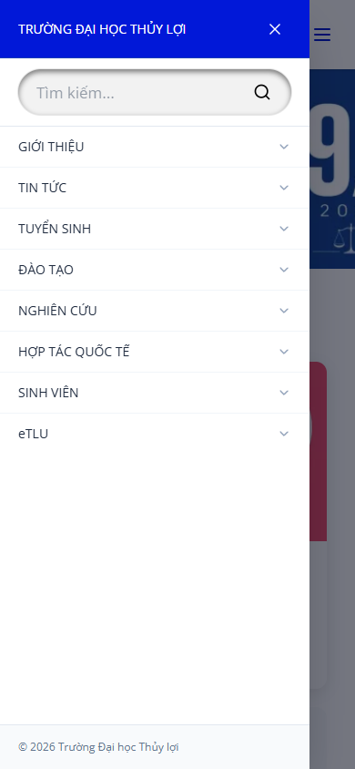

# BTTH01 — Phân tích website TLU

Môn CSE122. Khảo sát ngày 25/11/2026 (Asia/Saigon), URL https://tlu.edu.vn/. Bài này phân tích bố cục, không liên quan bài thơ Bốn mùa. AI đã thực hiện khảo sát tự động, biên soạn và rà soát tài liệu trong phiên này. Bài đang chờ Hà xem xét; chưa có bằng chứng Hà đã tự giải thích hoặc nghiệm thu.

## Mục lục

- [1. Bản đồ bố cục toàn trang](#phan-1)
- [2. Phân tích từng component](#phan-2)
- [3. Layout Box + tên class](#phan-3)
- [4. Flexbox/Grid/Block/Position](#phan-4)
- [5. Flex Container + Flex Items](#phan-5)
- [6. Kiểu nội dung bên trong](#phan-6)
- [7. HTML semantic phù hợp](#phan-7)
- [8. Phiên bản chỉ dùng div](#phan-8)
- [9. Phiên bản semantic HTML](#phan-9)
- [10. CSS layout minh họa](#phan-10)
- [11. Responsive behavior](#phan-11)
- [12. DOM tree toàn trang](#phan-12)
- [13. Bảng tổng hợp](#phan-13)
- [14. Checklist tư duy cho sinh viên](#phan-14)
- [15. Các lỗi tư duy phổ biến cần tránh](#phan-15)

## Căn cứ và mức xác nhận

- **Quan sát trực tiếp:** ảnh Edge headless desktop 1440×900 và mobile 390×844, cuộn đến cuối để tải ảnh. Full-page có thể ghép header sticky ở vị trí cuộn cuối; không dùng ảnh ghép để kết luận vị trí header trong luồng.
- **DOM/CSS:** snapshot HTML và JSON CSS tính toán; class gốc khác class đề xuất trong bài. main có class flex-1 nhưng display:block: flex-1 không đồng nghĩa display:flex.
- **Thao tác thật:** hover mục Giới thiệu desktop hiện danh sách; mobile bấm Mở menu, mở summary xác nhận details.open=true. Đã click Đóng menu nhưng đo ngay trong chuyển động, transform=none nên chưa xác nhận trạng thái đóng cuối. Click Tin tiếp theo hoàn tất nhưng chưa đo thay đổi slide.
- **Đề xuất dựng lại:** toàn bộ code minh họa trong COMPONENTS.md; không khẳng định là CSS gốc.
- **Chưa xác nhận:** gửi tìm kiếm, đổi ngôn ngữ, lightbox ảnh, tải bản đồ tương tác, các liên kết ngoài và mọi trạng thái bàn phím; tablet chưa chạy. Banner hero có thời điểm ảnh chưa hiển thị trọn trong ảnh chụp; không kết luận là thiết kế cố ý.

[Ảnh desktop](assets/desktop.png) · [Ảnh mobile](assets/mobile.png) · [Menu mobile](assets/mobile-menu.png) · [Dropdown desktop](assets/desktop-dropdown.png) · [Kết quả tương tác](assets/interactions.json)



Nguồn: [TLU](https://tlu.edu.vn/), master prompt do Hà cung cấp (đã đọc đủ); [DOM desktop](assets/desktop.html), [DOM mobile](assets/mobile.html), [CSS desktop](assets/desktop-sections.json), [CSS mobile](assets/mobile-sections.json). Số liệu thống kê chỉ là nội dung công bố trên website; ảnh đầu tiên có 0 do chưa kích hoạt khi cuộn, sau cuộn hiện giá trị, không dùng 0 làm số liệu trường.

<a id="phan-1"></a>

## 1. Bản đồ bố cục toàn trang

```text
page
├── site-header: header-tools (logo + search + language + menu-open), primary-nav
├── mobile-drawer (panel)
├── main
│   ├── hero
│   ├── news-layout: featured + news-stack + announcements
│   ├── events → event-card
│   ├── statistics
│   ├── identity-banner
│   ├── admissions
│   ├── audiences: training + student + alumni
│   ├── units
│   ├── international
│   ├── research
│   ├── partners
│   ├── community
│   └── moments
├── site-footer
└── social-rail
```
Các section trong main theo chiều dọc. Nội dung thường căn giữa max-width khoảng 1400px theo class DOM; banner và đơn vị có vùng phủ ngang. Footer chứa liên hệ, nhóm link và bản đồ.

<a id="phan-2"></a>

## 2. Phân tích từng component

Đọc [23 component theo mẫu 7 mục bắt buộc](COMPONENTS.md). Các vùng dùng lại mẫu news-card vẫn có mục riêng để ghi vai trò và responsive.

<a id="phan-3"></a>

## 3. Layout Box + tên class

Class đặt theo vai trò: news-card, event-date, admissions-body; tránh box1, blue-box, left-area. Dùng hậu tố -list/-card/-title/-body/-image nhất quán. Tên chỉ vị trí dễ sai khi mobile đổi thứ tự.

<a id="phan-4"></a>

## 4. Flexbox/Grid/Block/Position

**Xác nhận gốc:** admissions grid hai cột 648px tại desktop; audiences grid ba cột khoảng 429px; units display:flex, hai con flex. **Đề xuất:** dùng Grid cho vùng chuyên mục 3 thẻ + list và gallery; Flex cho một hàng menu/logo; Normal Flow cho body thẻ; Position cho ngày phủ ảnh. Grid giải quyết hàng × cột, flex-wrap chỉ phân phối từng dòng độc lập.

<a id="phan-5"></a>

## 5. Flex Container + Flex Items

```text
ĐỀ XUẤT (items là con trực tiếp)
header-tools [flex] → brand, search-form, language, menu-open
  language-list [nested flex] → li
nav-list [flex] → li.nav-item
  nav-link [nested flex] → span nhãn, span biểu tượng
events-track [flex, nowrap + overflow] → article.event-card
units-content [flex] → units-list, units-preview
  units-list [nested flex column] → a
  units-preview [nested flex column] → img, a, figcaption
partner-list [flex + wrap] → li
social-rail [fixed + flex column] → a
news-body [Normal Flow] → h3, p, time
```


Nếu dùng flex cho tin chính và sidebar: .news-main {flex:2;min-width:0} và .announcements {flex:1;min-width:0}: tỷ lệ phần không gian dư là 2:1, không phải hai phần ba viewport khi còn gap/padding. Đây là lựa chọn thay thế, không phải tỷ lệ đo từ TLU.

<a id="phan-6"></a>

## 6. Kiểu nội dung bên trong

Ảnh thương hiệu/banner/tin; tiêu đề chuyên mục và bài; đoạn mô tả; ngày; danh sách thông báo; số liệu nhãn–giá trị; link điều hướng; thao tác menu/chuyển slide; trường tìm kiếm; liên hệ và bản đồ. Bảng từng hộp ở COMPONENTS.md gắn nội dung với thẻ ngay tại component.

<a id="phan-7"></a>

## 7. HTML semantic phù hợp

h1 dành cho danh tính trang, h2 cho chuyên mục, h3 cho bài. a chuyển địa chỉ, button thao tác. time có datetime ISO; ul/li cho danh sách; dl/dt/dd cho thống kê; address cho liên hệ; figure/figcaption khi ảnh có chú thích. Không tự thay mọi div bằng section.

<a id="phan-8"></a>

## 8. Phiên bản chỉ dùng div

Mỗi component có phiên bản chỉ div tại mục 4 của [COMPONENTS.md](COMPONENTS.md). Div không tự có khả năng nhập, click bàn phím, điều hướng hoặc ngữ nghĩa; đây là mô hình học hộp.

<a id="phan-9"></a>

## 9. Phiên bản semantic HTML

Mỗi component có bản semantic tại mục 5 của [COMPONENTS.md](COMPONENTS.md). Giữ class tương ứng để thấy thay thẻ không buộc thay mô hình layout. Code là mảnh minh họa, không phải ứng dụng TLU hoàn chỉnh.

<a id="phan-10"></a>

## 10. CSS layout minh họa

```css
.container { width:min(100% - 2rem,1400px); margin-inline:auto; }
img { max-width:100%; height:auto; }
.news-card { min-width:0; }
.topic-grid { display:grid; grid-template-columns:repeat(4,minmax(0,1fr)); gap:1rem; }
@media(max-width:1024px) { .topic-grid { grid-template-columns:repeat(2,minmax(0,1fr)); } }
@media(max-width:767px) { .topic-grid { grid-template-columns:1fr; } }
```


CSS riêng cho mỗi hộp nằm cạnh hai bản HTML trong COMPONENTS.md. Gap nằm trên container; min-width:0 giúp item co khi tiêu đề dài.

<a id="phan-11"></a>

## 11. Responsive behavior

| Vùng | Desktop quan sát | Mobile khảo sát / giới hạn | Đề xuất tablet |
|---|---|---|---|
| Điều hướng | Hàng ngang | Nút mở drawer; details mở được | Dùng drawer khi menu không đủ chỗ |
| Tuyển sinh | Grid 2 cột | Grid 1 cột 358px (computed style) | 2 cột nếu đủ chỗ |
| Ba đối tượng | Grid 3 cột | Grid 1 cột 358px (computed style) | 2 hoặc 3 cột theo độ dài |
| Tin/chuyên mục | Thẻ + list cạnh nhau | Tin chính trên, tin phụ rồi thông báo; chuyên mục hiện 1 thẻ và chấm điều hướng | 2 cột |
| Gallery | Ô lớn xen ô nhỏ | Lưới 3 cột, ảnh lớn ở giữa; chưa thử lightbox | Giảm cột, reset span |

Viewport mobile đo scrollWidth=390, không tràn ngang ở trạng thái ban đầu. Không suy rộng ra mọi trạng thái hoặc mọi thiết bị.

<a id="phan-12"></a>

## 12. DOM tree toàn trang

Hai cây là DOM đề xuất theo ví dụ, không phải DOM TLU gốc. Liệt kê đủ mọi vùng chính; các component tin, tìm kiếm và sự kiện được mở rộng ở đúng vùng cha.

### DOM chỉ dùng div

```text
div.page
├── div.site-header
│   ├── div.header-tools
│   │   ├── div.brand
│   │   │   └── div.brand-image
│   │   ├── div.search-form
│   │   │   ├── div.search-label
│   │   │   └── div.search-field
│   │   │       ├── div.search-input
│   │   │       └── div.search-submit
│   │   ├── div.language
│   │   │   └── div.language-list
│   │   │       ├── div
│   │   │       │   └── div
│   │   │       └── div
│   │   │           └── div
│   │   └── div.menu-open
│   └── div.primary-nav
│       └── div.nav-list
│           ├── div.nav-item
│           │   ├── div.nav-link
│           │   │   ├── div
│           │   │   └── div
│           │   └── div.nav-submenu
│           │       ├── div
│           │       │   └── div
│           │       └── div
│           │           └── div
│           ├── div.nav-item
│           │   └── div.nav-link
│           └── div.nav-item
│               └── div.nav-link
├── div.mobile-drawer
│   ├── div.drawer-heading
│   │   ├── div
│   │   └── div.menu-close
│   ├── div.search-form
│   │   ├── div.search-label
│   │   └── div.search-field
│   │       ├── div.search-input
│   │       └── div.search-submit
│   └── div.drawer-nav
│       ├── div
│       │   ├── div
│       │   └── div
│       │       ├── div
│       │       │   └── div
│       │       └── div
│       │           └── div
│       └── div
│           ├── div
│           └── div
│               ├── div
│               │   └── div
│               └── div
│                   └── div
├── div.main-content
│   ├── div
│   ├── div.hero
│   │   ├── div
│   │   └── div.hero-frame
│   │       ├── div.hero-image
│   │       └── div.hero-pagination
│   │           ├── div
│   │           └── div
│   ├── div.news-layout
│   │   ├── div
│   │   └── div.news-columns
│   │       ├── div.news-card.featured-news
│   │       │   ├── div.news-image
│   │       │   └── div.news-body
│   │       │       ├── div.news-title
│   │       │       │   └── div
│   │       │       ├── div.news-summary
│   │       │       └── div.news-date
│   │       ├── div.news-stack
│   │       │   ├── div.news-card
│   │       │   │   ├── div.news-image
│   │       │   │   └── div.news-body
│   │       │   │       ├── div.news-title
│   │       │   │       │   └── div
│   │       │   │       ├── div.news-summary
│   │       │   │       └── div.news-date
│   │       │   └── div.news-card
│   │       │       ├── div.news-image
│   │       │       └── div.news-body
│   │       │           ├── div.news-title
│   │       │           │   └── div
│   │       │           ├── div.news-summary
│   │       │           └── div.news-date
│   │       └── div.announcements
│   │           ├── div
│   │           └── div.compact-list
│   │               ├── div
│   │               │   ├── div
│   │               │   └── div
│   │               └── div
│   │                   ├── div
│   │                   └── div
│   ├── div.events
│   │   ├── div
│   │   └── div.events-track
│   │       ├── div.event-card
│   │       │   ├── div.event-media
│   │       │   │   ├── div.event-image
│   │       │   │   └── div.event-date
│   │       │   └── div
│   │       │       └── div
│   │       └── div.event-card
│   │           ├── div.event-media
│   │           │   ├── div.event-image
│   │           │   └── div.event-date
│   │           └── div
│   │               └── div
│   ├── div.statistics
│   │   ├── div
│   │   └── div.statistics-grid
│   │       ├── div.stat-item
│   │       │   ├── div
│   │       │   └── div
│   │       ├── div.stat-item
│   │       │   ├── div
│   │       │   └── div
│   │       ├── div.stat-item
│   │       │   ├── div
│   │       │   └── div
│   │       ├── div.stat-item
│   │       │   ├── div
│   │       │   └── div
│   │       └── div.stat-item
│   │           ├── div
│   │           └── div
│   ├── div.identity-banner
│   │   ├── div.identity-image
│   │   └── div
│   ├── div.admissions
│   │   └── div.admissions-grid
│   │       ├── div.admissions-image
│   │       └── div.admissions-body
│   │           ├── div
│   │           ├── div
│   │           ├── div
│   │           │   ├── div
│   │           │   │   └── div
│   │           │   ├── div
│   │           │   │   └── div
│   │           │   └── div
│   │           │       └── div
│   │           └── div.admissions-link
│   ├── div.audiences
│   │   ├── div.audience-column
│   │   │   ├── div
│   │   │   └── div.training-card
│   │   │       ├── div.news-image
│   │   │       └── div.news-body
│   │   │           ├── div.news-title
│   │   │           │   └── div
│   │   │           ├── div.news-summary
│   │   │           └── div.news-date
│   │   ├── div.audience-column
│   │   │   ├── div
│   │   │   └── div.student-card
│   │   │       ├── div.news-image
│   │   │       └── div.news-body
│   │   │           ├── div.news-title
│   │   │           │   └── div
│   │   │           ├── div.news-summary
│   │   │           └── div.news-date
│   │   └── div.audience-column
│   │       ├── div
│   │       └── div.alumni-card
│   │           ├── div.news-image
│   │           └── div.news-body
│   │               ├── div.news-title
│   │               │   └── div
│   │               ├── div.news-summary
│   │               └── div.news-date
│   ├── div.units
│   │   ├── div
│   │   └── div.units-content
│   │       ├── div.units-list
│   │       │   ├── div
│   │       │   ├── div
│   │       │   └── div
│   │       └── div.units-preview
│   │           ├── div.units-image
│   │           ├── div.units-link
│   │           └── div
│   ├── div.international
│   │   ├── div
│   │   └── div.topic-grid
│   │       ├── div.news-card
│   │       │   ├── div.news-image
│   │       │   └── div.news-body
│   │       │       ├── div.news-title
│   │       │       │   └── div
│   │       │       ├── div.news-summary
│   │       │       └── div.news-date
│   │       ├── div.news-card
│   │       │   ├── div.news-image
│   │       │   └── div.news-body
│   │       │       ├── div.news-title
│   │       │       │   └── div
│   │       │       ├── div.news-summary
│   │       │       └── div.news-date
│   │       ├── div.news-card
│   │       │   ├── div.news-image
│   │       │   └── div.news-body
│   │       │       ├── div.news-title
│   │       │       │   └── div
│   │       │       ├── div.news-summary
│   │       │       └── div.news-date
│   │       └── div.compact-list
│   │           ├── div
│   │           │   ├── div
│   │           │   └── div
│   │           └── div
│   │               ├── div
│   │               └── div
│   ├── div.research
│   │   ├── div
│   │   └── div.topic-grid
│   │       ├── div.news-card
│   │       │   ├── div.news-image
│   │       │   └── div.news-body
│   │       │       ├── div.news-title
│   │       │       │   └── div
│   │       │       ├── div.news-summary
│   │       │       └── div.news-date
│   │       ├── div.news-card
│   │       │   ├── div.news-image
│   │       │   └── div.news-body
│   │       │       ├── div.news-title
│   │       │       │   └── div
│   │       │       ├── div.news-summary
│   │       │       └── div.news-date
│   │       ├── div.news-card
│   │       │   ├── div.news-image
│   │       │   └── div.news-body
│   │       │       ├── div.news-title
│   │       │       │   └── div
│   │       │       ├── div.news-summary
│   │       │       └── div.news-date
│   │       └── div.compact-list
│   │           ├── div
│   │           │   ├── div
│   │           │   └── div
│   │           └── div
│   │               ├── div
│   │               └── div
│   ├── div.partners
│   │   ├── div
│   │   ├── div
│   │   └── div.partner-list
│   │       ├── div
│   │       │   └── div.partner-logo
│   │       └── div
│   │           └── div.partner-logo
│   ├── div.community
│   │   ├── div
│   │   └── div.topic-grid
│   │       ├── div.news-card
│   │       │   ├── div.news-image
│   │       │   └── div.news-body
│   │       │       ├── div.news-title
│   │       │       │   └── div
│   │       │       ├── div.news-summary
│   │       │       └── div.news-date
│   │       ├── div.news-card
│   │       │   ├── div.news-image
│   │       │   └── div.news-body
│   │       │       ├── div.news-title
│   │       │       │   └── div
│   │       │       ├── div.news-summary
│   │       │       └── div.news-date
│   │       ├── div.news-card
│   │       │   ├── div.news-image
│   │       │   └── div.news-body
│   │       │       ├── div.news-title
│   │       │       │   └── div
│   │       │       ├── div.news-summary
│   │       │       └── div.news-date
│   │       └── div.compact-list
│   │           ├── div
│   │           │   ├── div
│   │           │   └── div
│   │           └── div
│   │               ├── div
│   │               └── div
│   └── div.moments
│       ├── div
│       └── div.moments-grid
│           ├── div.moment-image
│           │   └── div.moment-photo
│           ├── div.moment-feature
│           │   └── div.moment-photo
│           ├── div.moment-image
│           │   └── div.moment-photo
│           └── div.moment-image
│               └── div.moment-photo
├── div.site-footer
│   ├── div.footer-columns
│   │   ├── div.contact-info
│   │   │   ├── div
│   │   │   ├── div
│   │   │   ├── div
│   │   │   ├── div
│   │   │   └── div
│   │   ├── div.footer-links
│   │   │   ├── div
│   │   │   └── div
│   │   │       ├── div
│   │   │       │   └── div
│   │   │       └── div
│   │   │           └── div
│   │   ├── div.social-links
│   │   │   ├── div
│   │   │   └── div
│   │   │       ├── div
│   │   │       │   └── div
│   │   │       └── div
│   │   │           └── div
│   │   └── div.campus-map
│   │       ├── div
│   │       ├── div
│   │       └── div
│   └── div.copyright
└── div.social-rail
    ├── div.social-link
    ├── div.social-link
    └── div.social-link
```

### DOM semantic HTML

```text
body.page
├── header.site-header
│   ├── div.header-tools
│   │   ├── a.brand
│   │   │   └── img.brand-image
│   │   ├── form.search-form
│   │   │   ├── label.search-label
│   │   │   └── div.search-field
│   │   │       ├── input.search-input
│   │   │       └── button.search-submit
│   │   ├── nav.language
│   │   │   └── ul.language-list
│   │   │       ├── li
│   │   │       │   └── a
│   │   │       └── li
│   │   │           └── a
│   │   └── button.menu-open
│   └── nav.primary-nav
│       └── ul.nav-list
│           ├── li.nav-item
│           │   ├── a.nav-link
│           │   │   ├── span
│           │   │   └── span
│           │   └── ul.nav-submenu
│           │       ├── li
│           │       │   └── a
│           │       └── li
│           │           └── a
│           ├── li.nav-item
│           │   └── a.nav-link
│           └── li.nav-item
│               └── a.nav-link
├── aside.mobile-drawer
│   ├── div.drawer-heading
│   │   ├── h2
│   │   └── button.menu-close
│   ├── form.search-form
│   │   ├── label.search-label
│   │   └── div.search-field
│   │       ├── input.search-input
│   │       └── button.search-submit
│   └── nav.drawer-nav
│       ├── details
│       │   ├── summary
│       │   └── ul
│       │       ├── li
│       │       │   └── a
│       │       └── li
│       │           └── a
│       └── details
│           ├── summary
│           └── ul
│               ├── li
│               │   └── a
│               └── li
│                   └── a
├── main.main-content
│   ├── h1
│   ├── section.hero
│   │   ├── h2
│   │   └── div.hero-frame
│   │       ├── img.hero-image
│   │       └── div.hero-pagination
│   │           ├── button
│   │           └── button
│   ├── section.news-layout
│   │   ├── h2
│   │   └── div.news-columns
│   │       ├── article.news-card.featured-news
│   │       │   ├── img.news-image
│   │       │   └── div.news-body
│   │       │       ├── h3.news-title
│   │       │       │   └── a
│   │       │       ├── p.news-summary
│   │       │       └── time.news-date
│   │       ├── div.news-stack
│   │       │   ├── article.news-card
│   │       │   │   ├── img.news-image
│   │       │   │   └── div.news-body
│   │       │   │       ├── h3.news-title
│   │       │   │       │   └── a
│   │       │   │       ├── p.news-summary
│   │       │   │       └── time.news-date
│   │       │   └── article.news-card
│   │       │       ├── img.news-image
│   │       │       └── div.news-body
│   │       │           ├── h3.news-title
│   │       │           │   └── a
│   │       │           ├── p.news-summary
│   │       │           └── time.news-date
│   │       └── aside.announcements
│   │           ├── h2
│   │           └── ul.compact-list
│   │               ├── li
│   │               │   ├── a
│   │               │   └── time
│   │               └── li
│   │                   ├── a
│   │                   └── time
│   ├── section.events
│   │   ├── h2
│   │   └── div.events-track
│   │       ├── article.event-card
│   │       │   ├── div.event-media
│   │       │   │   ├── img.event-image
│   │       │   │   └── time.event-date
│   │       │   └── h3
│   │       │       └── a
│   │       └── article.event-card
│   │           ├── div.event-media
│   │           │   ├── img.event-image
│   │           │   └── time.event-date
│   │           └── h3
│   │               └── a
│   ├── section.statistics
│   │   ├── h2
│   │   └── dl.statistics-grid
│   │       ├── div.stat-item
│   │       │   ├── dt
│   │       │   └── dd
│   │       ├── div.stat-item
│   │       │   ├── dt
│   │       │   └── dd
│   │       ├── div.stat-item
│   │       │   ├── dt
│   │       │   └── dd
│   │       ├── div.stat-item
│   │       │   ├── dt
│   │       │   └── dd
│   │       └── div.stat-item
│   │           ├── dt
│   │           └── dd
│   ├── figure.identity-banner
│   │   ├── img.identity-image
│   │   └── figcaption
│   ├── section.admissions
│   │   └── div.admissions-grid
│   │       ├── img.admissions-image
│   │       └── div.admissions-body
│   │           ├── h2
│   │           ├── p
│   │           ├── ul
│   │           │   ├── li
│   │           │   │   └── a
│   │           │   ├── li
│   │           │   │   └── a
│   │           │   └── li
│   │           │       └── a
│   │           └── a.admissions-link
│   ├── div.audiences
│   │   ├── section.audience-column
│   │   │   ├── h2
│   │   │   └── article.training-card
│   │   │       ├── img.news-image
│   │   │       └── div.news-body
│   │   │           ├── h3.news-title
│   │   │           │   └── a
│   │   │           ├── p.news-summary
│   │   │           └── time.news-date
│   │   ├── section.audience-column
│   │   │   ├── h2
│   │   │   └── article.student-card
│   │   │       ├── img.news-image
│   │   │       └── div.news-body
│   │   │           ├── h3.news-title
│   │   │           │   └── a
│   │   │           ├── p.news-summary
│   │   │           └── time.news-date
│   │   └── section.audience-column
│   │       ├── h2
│   │       └── article.alumni-card
│   │           ├── img.news-image
│   │           └── div.news-body
│   │               ├── h3.news-title
│   │               │   └── a
│   │               ├── p.news-summary
│   │               └── time.news-date
│   ├── section.units
│   │   ├── h2
│   │   └── div.units-content
│   │       ├── nav.units-list
│   │       │   ├── a
│   │       │   ├── a
│   │       │   └── a
│   │       └── figure.units-preview
│   │           ├── img.units-image
│   │           ├── a.units-link
│   │           └── figcaption
│   ├── section.international
│   │   ├── h2
│   │   └── div.topic-grid
│   │       ├── article.news-card
│   │       │   ├── img.news-image
│   │       │   └── div.news-body
│   │       │       ├── h3.news-title
│   │       │       │   └── a
│   │       │       ├── p.news-summary
│   │       │       └── time.news-date
│   │       ├── article.news-card
│   │       │   ├── img.news-image
│   │       │   └── div.news-body
│   │       │       ├── h3.news-title
│   │       │       │   └── a
│   │       │       ├── p.news-summary
│   │       │       └── time.news-date
│   │       ├── article.news-card
│   │       │   ├── img.news-image
│   │       │   └── div.news-body
│   │       │       ├── h3.news-title
│   │       │       │   └── a
│   │       │       ├── p.news-summary
│   │       │       └── time.news-date
│   │       └── ul.compact-list
│   │           ├── li
│   │           │   ├── a
│   │           │   └── time
│   │           └── li
│   │               ├── a
│   │               └── time
│   ├── section.research
│   │   ├── h2
│   │   └── div.topic-grid
│   │       ├── article.news-card
│   │       │   ├── img.news-image
│   │       │   └── div.news-body
│   │       │       ├── h3.news-title
│   │       │       │   └── a
│   │       │       ├── p.news-summary
│   │       │       └── time.news-date
│   │       ├── article.news-card
│   │       │   ├── img.news-image
│   │       │   └── div.news-body
│   │       │       ├── h3.news-title
│   │       │       │   └── a
│   │       │       ├── p.news-summary
│   │       │       └── time.news-date
│   │       ├── article.news-card
│   │       │   ├── img.news-image
│   │       │   └── div.news-body
│   │       │       ├── h3.news-title
│   │       │       │   └── a
│   │       │       ├── p.news-summary
│   │       │       └── time.news-date
│   │       └── ul.compact-list
│   │           ├── li
│   │           │   ├── a
│   │           │   └── time
│   │           └── li
│   │               ├── a
│   │               └── time
│   ├── section.partners
│   │   ├── h2
│   │   ├── p
│   │   └── ul.partner-list
│   │       ├── li
│   │       │   └── img.partner-logo
│   │       └── li
│   │           └── img.partner-logo
│   ├── section.community
│   │   ├── h2
│   │   └── div.topic-grid
│   │       ├── article.news-card
│   │       │   ├── img.news-image
│   │       │   └── div.news-body
│   │       │       ├── h3.news-title
│   │       │       │   └── a
│   │       │       ├── p.news-summary
│   │       │       └── time.news-date
│   │       ├── article.news-card
│   │       │   ├── img.news-image
│   │       │   └── div.news-body
│   │       │       ├── h3.news-title
│   │       │       │   └── a
│   │       │       ├── p.news-summary
│   │       │       └── time.news-date
│   │       ├── article.news-card
│   │       │   ├── img.news-image
│   │       │   └── div.news-body
│   │       │       ├── h3.news-title
│   │       │       │   └── a
│   │       │       ├── p.news-summary
│   │       │       └── time.news-date
│   │       └── ul.compact-list
│   │           ├── li
│   │           │   ├── a
│   │           │   └── time
│   │           └── li
│   │               ├── a
│   │               └── time
│   └── section.moments
│       ├── h2
│       └── div.moments-grid
│           ├── button.moment-image
│           │   └── img.moment-photo
│           ├── button.moment-feature
│           │   └── img.moment-photo
│           ├── button.moment-image
│           │   └── img.moment-photo
│           └── button.moment-image
│               └── img.moment-photo
├── footer.site-footer
│   ├── div.footer-columns
│   │   ├── address.contact-info
│   │   │   ├── br
│   │   │   ├── br
│   │   │   ├── a
│   │   │   ├── br
│   │   │   └── a
│   │   ├── nav.footer-links
│   │   │   ├── h2
│   │   │   └── ul
│   │   │       ├── li
│   │   │       │   └── a
│   │   │       └── li
│   │   │           └── a
│   │   ├── nav.social-links
│   │   │   ├── h2
│   │   │   └── ul
│   │   │       ├── li
│   │   │       │   └── a
│   │   │       └── li
│   │   │           └── a
│   │   └── section.campus-map
│   │       ├── h2
│   │       ├── p
│   │       └── button
│   └── p.copyright
└── nav.social-rail
    ├── a.social-link
    ├── a.social-link
    └── a.social-link
```

<a id="phan-13"></a>

## 13. Bảng tổng hợp

| Component / Layout Box | Layout technique, container và items | Nội dung | HTML semantic chính |
|---|---|---|---|
| page | Normal Flow | Toàn trang | body, header, h1, main, section, h2, p, footer |
| site-header | Flex: header-tools → brand, form, language, menu-open | Nhận diện và công cụ | header, div, a, img, form, label, input, button, nav, ul, li |
| search-form | Flow + Position: field relative → submit absolute | Tìm kiếm | form, label, div, input, button |
| primary-nav | Nested Flex: nav-list → li; nav-link → span | Điều hướng desktop | nav, ul, li, a, span |
| mobile-drawer | Fixed; heading Flex → h2, button | Menu mobile | aside, div, h2, button, form, label, input, nav, details, summary, ul, li, a |
| hero | Relative frame → absolute pagination; Flex → button | Banner đầu trang | section, h2, div, img, button |
| news-layout | Grid news-columns: featured, stack, aside | Tin tức và thông báo | section, h2, div, article, img, h3, a, p, time, aside, ul, li |
| news-card | Normal Flow | Thẻ tin | article, img, div, h3, a, p, time |
| announcements | Normal Flow | Danh sách thông báo | aside, h2, ul, li, a, time |
| events | Flex events-track → event-card; nowrap | Sự kiện | section, h2, div, article, img, time, h3, a |
| event-card | Relative event-media → absolute event-date | Thẻ sự kiện | article, div, img, time, h3, a |
| statistics | Grid statistics-grid → stat-item | Những con số ấn tượng | section, h2, dl, div, dt, dd |
| identity-banner | Normal Flow | Banner thông điệp | figure, img, figcaption |
| admissions | Grid admissions-grid → img, body | Tuyển sinh | section, div, img, h2, p, ul, li, a |
| audiences | Grid → 3 section | Đào tạo / Sinh viên / Cựu sinh viên | div, section, h2, article, img, h3, a, p, time |
| units | Nested Flex: content → list, preview; mỗi con Flex | Các đơn vị đào tạo, KHCN | section, h2, div, nav, a, figure, img, figcaption |
| international | Grid topic-grid → 3 article + ul | Hợp tác quốc tế | section, h2, div, article, img, h3, a, p, time, ul, li |
| research | Grid topic-grid → 3 article + ul | Nghiên cứu | section, h2, div, article, img, h3, a, p, time, ul, li |
| partners | Flex partner-list → li; wrap | Mạng lưới đối tác | section, h2, p, ul, li, img |
| community | Grid topic-grid → 3 article + ul | Vì cộng đồng | section, h2, div, article, img, h3, a, p, time, ul, li |
| moments | Grid moments-grid; feature span 3 × 2 | Khoảnh khắc TLU | section, h2, div, button, img |
| site-footer | Grid footer-columns → address, nav, nav, section | Chân trang | footer, div, address, br, a, nav, h2, ul, li, section, p, button |
| social-rail | Fixed + Flex column → a | Liên kết mạng xã hội nổi | nav, a |

<a id="phan-14"></a>

## 14. Checklist tư duy cho sinh viên

- [x] Đọc master prompt, đủ 15 phần và 23 mục component, mỗi mục 7 bước.
- [x] Phân biệt nguồn gốc, đề xuất và điều chưa xác nhận.
- [x] Có screenshot, DOM/CSS và log thao tác hai viewport.
- [x] Đã mở bản render GitHub bằng phiên không đăng nhập; phát hiện và sửa phần lặp. Kết quả kiểm tra lại ghi tại KIEM_TRA.md.
- [ ] Các tương tác chưa xác nhận đã nêu ở phần căn cứ; không coi là đạt.

Cây quyết định: khoanh hộp → đặt tên theo vai trò → xác định cha/con → cần hàng và cột đồng bộ? Grid → chỉ một trục? Flex → xếp dọc tự nhiên? Flow → phủ lên vùng khác? Position với mốc rõ → nhận diện nội dung → chọn thẻ → kiểm tra màn hình hẹp và bàn phím.

Trước nộp: tự giải thích tại sao main block vẫn có class flex-1; vì sao ảnh + ngày phủ dùng relative/absolute; vì sao button không thay bằng div.

<a id="phan-15"></a>

## 15. Các lỗi tư duy phổ biến cần tránh

1. Nhìn ảnh rồi kết luận CSS gốc dùng Flexbox. Phải đo computed style.
2. Nhầm flex item với flex container, hoặc coi mọi phần tử cháu là item trực tiếp.
3. Dùng absolute cho toàn bộ trang làm vỡ luồng khi văn bản dài.
4. Dùng flex-wrap cho gallery cần span hàng/cột.
5. Gọi mọi vùng là div, bỏ heading, list, time và form.
6. Chọn button cho link chuyển trang hoặc div cho nút.
7. Dùng màu/vị trí đặt class thay vì vai trò.
8. Xem snapshot ban đầu 0 là thống kê chính thức, bỏ qua cuộn/animation.
9. Click thành công rồi tuyên bố carousel chuyển đúng mà chưa đo trạng thái.
10. Coi screenshot full-page là bằng chứng mọi ảnh đã tải hoặc mọi sticky đúng vị trí.
11. Ghi đã kiểm thử tablet, GitHub, tìm kiếm khi chưa chạy.
12. Sao chép ví dụ placeholder làm sản phẩm cuối mà không bổ sung alt, label, heading, nội dung thật.


## Ghi chú kiểm tra ảnh và bàn giao

Đã xem ảnh desktop toàn trang, mobile toàn trang và menu mobile. Mobile: thống kê có chỉ số đầu riêng, các chỉ số còn lại thành hai cột; đơn vị chuyển thành khối dọc; logo đối tác thấy hai logo tại thời điểm chụp; footer xếp dọc. Một số ảnh thẻ chuyên mục mobile còn là nền trống dù đã cuộn và chờ: chưa xác nhận nguyên nhân, không coi nền trống là thiết kế gốc. Chưa kiểm chứng tablet và trình đọc màn hình.

Trạng thái xuất bản: đã push bài lên nhánh `main`. Lỗi lặp phần 14–15 và tiêu đề DOM được phát hiện khi mở GitHub và đã sửa trong lần xuất bản này. Hà chưa xác nhận nghiệm thu.

[Hồ sơ rà soát và kiểm tra GitHub](KIEM_TRA.md).
